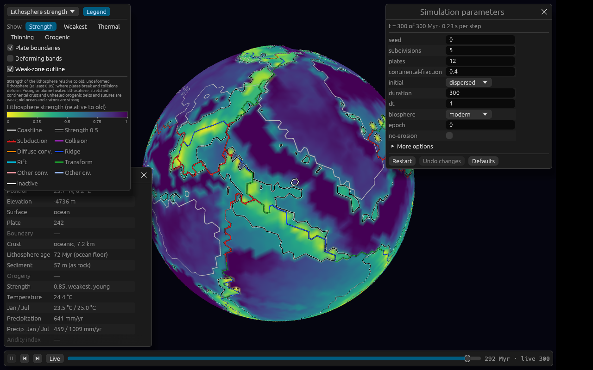
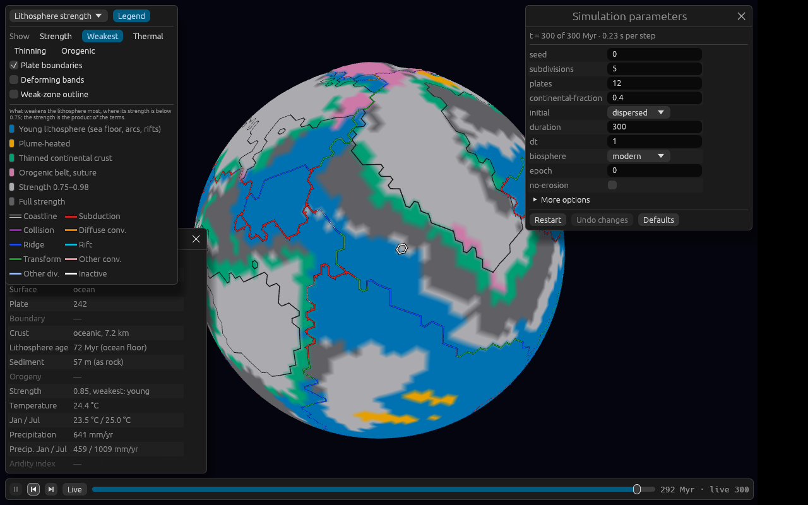
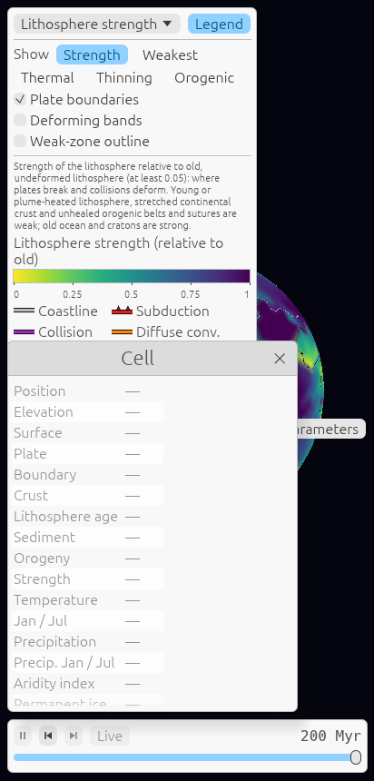

# Issue #101: lithosphere-strength render mode — results

## What was built
- Render mode **Lithosphere strength** (`--render-mode lithosphere-strength`, `?render-mode=…`):
  - *Show*: **Strength** (combined, as the simulation uses it), **Weakest** (the weakest term per
    cell as a category: young lithosphere, plume-heated, thinned crust, orogenic belt/suture),
    or one term: **Thermal**, **Thinning**, **Orogenic**.
  - Scale: viridis reversed (perceptually uniform, colour-blind safe; weak = bright yellow,
    strong = dark purple), unlit; categories in Okabe–Ito colours, shown only where the strength
    is below 0.75 (0.75–0.98 light grey, full strength dark grey) so that hue never has to be
    read at low saturation.
  - Overlays: plate boundaries as in the Plates mode (default on, narrower), deforming bands
    (#69, off), weak-zone outline = isoline at strength 0.5, the floor of the deforming-band
    weights (`MIN_BAND_STRENGTH`, off); coastlines always.
  - Cell widget: row **Strength**, e.g. `0.42, weakest: orogenic` or `1.00 (full)`.
- Works on past frames (#115): everything comes from the frame.
- Coastlines pale grey on the colour scale and dark on the greys of the Weakest view; the
  weak-zone outline is black with a white border (white lines are inactive boundaries).

Checked: the state hash of seed 0 at 0 and 100 Myr equals main's (results unchanged); desktop
(5 subdivisions, live and a past frame) and the web build at phone width (412 px, 4
subdivisions: options wrap onto two rows, legend and cell button usable).

## Data
`lithosphere_strength` is not a pure function of what the frame had: the plume reset
(`Crust::reheated`), the basement thickness (without metasediment) and the continental origin
are missing. So the simulation now exports the two terms that need them — `strength_thermal`
and `strength_thinning` (`Simulation::lithosphere_strength_terms`) — and the viewer combines
them with the frame's `orogenic` through the simulation's own `combine_strength` (which
`lithosphere_strength` calls as well; same operations in the same order, results unchanged).
- `CellInfo`: 84 → 92 bytes. History: two 1-byte `Share` channels, 39 → 41 bytes per cell. No
  flag bits used (the review proposed a flag bit for the plume reset; the low 8 flag bits are
  taken by the open PRs #140/#142).
- Combined strength after quantisation: within ~0.005 (three terms at 1/508).
- Plume heating is recognised where the thermal term is more than 0.025 below the term of the
  frame's age; a unit test checks that young lithosphere (0–25 Myr, with the age rounded to
  0.25 Myr and the term to 1/254) never shows as plume-heated.

## Strength on the planet (seeds 0–3, 500 Myr runs of main, cell dumps)
Script: [`strength_stats.py`](strength_stats.py) on the cell and boundary dumps. Strength p10/p50/p90 and the share
below 0.5:

| | t = 100 Myr | t = 500 Myr |
|---|---|---|
| all cells | 0.29–0.32 / 0.78–0.87 / 1.00; < 0.5: 21–25% | 0.23–0.33 / 0.65–0.76 / 0.98–1.00; < 0.5: 22–36% |
| oceanic | median 0.64–0.93 | median 0.55–0.67 |
| continental origin | median 0.85–0.87, < 0.5: 10–12% | median 0.78–0.84, < 0.5: 9–27% |
| ridge/rift boundary cells | median 0.15–0.16, 100% < 0.5 | median 0.14–0.15, 100% < 0.5 |
| collision boundary cells | median 0.30–0.71 | median 0.26–0.31, < 0.5: 57–76% |
| subduction / transform boundary cells | median 0.57–0.75 | median 0.47–0.74 |
| orogenic weakening ≥ 0.25 | 1–2% of cells, median 0.25–0.35 | 4.5–10% of cells, median 0.34–0.60 |
| plume-reset cells | 1.3–2.4%, median 0.68–0.85 | 2.0–6.5%, median 0.78–0.89 |

Weakest term of the lithosphere weaker than 0.75 (34–60% of the planet): young lithosphere
71–78%, thinned continental crust 10–20%, orogenic 2–5% at 100 Myr and 7–13% at 500 Myr,
plume-heated 0–2%.

**Where weak zones sit:** as expected at ridges and fresh rifts (the weakest, all below 0.5),
in collision belts and sutures, along stretched continental margins, and in young sea floor.
Old ocean and undeformed cratons are at full strength.

**Weaknesses of the model it shows** (reported on GitHub, not fixed here):
1. Young lithosphere dominates the weak zones (71–78% of the lithosphere weaker than 0.75; mostly
   young sea floor, plus arcs and freshly rifted continental crust): the proxy has no
   compositional or rheological term, so 50 Myr old ocean (0.71) is as weak as a half-healed
   orogenic belt and competes with mobile belts as a place to break. On Earth, rifts follow
   continental mobile belts; young oceanic plates rarely break internally away from ridges.
2. 8–18% of the continental cells on collision boundaries at 500 Myr are at full strength
   (≥ 0.95) and were never marked as orogenic, though thickened (median 42–49 km): one side of
   the collision front is not weakened (last block of the script).
3. Plume heating weakens little (reset cells median 0.8; < 2% of the weak lithosphere): a
   parameter choice — the head centre is reset to a thermal age of 25 Myr (term 0.5), tapering
   to none at the edge, and the reset cells have cooled since.

The coarse grid (~110 km cells; ~220 km on the web) makes ridges and sutures one or two cells
wide; the weak zones are drawn that wide, which is a grid artefact.

## Independent review of the results (summary)
No correctness bugs found (refactor keeps the operations; Plates mode draws as before; codec
order consistent). Fixed after it: the Weakest legend gives each category its own row and says
"Strength 0.75–0.98"; codec comment (~0.005); two ranges in the table; the collision-front
statistic is now computed by the script; weakness 1 reworded (the "young" category includes
arcs and rifted crust); weakness 3 attributed to the plume parameters; the thinning title names
the basement (crust without metasediment).
