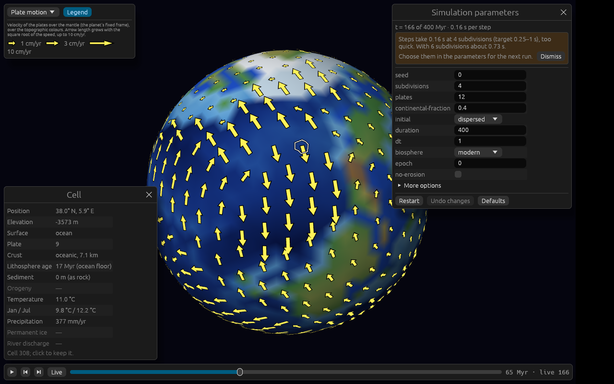
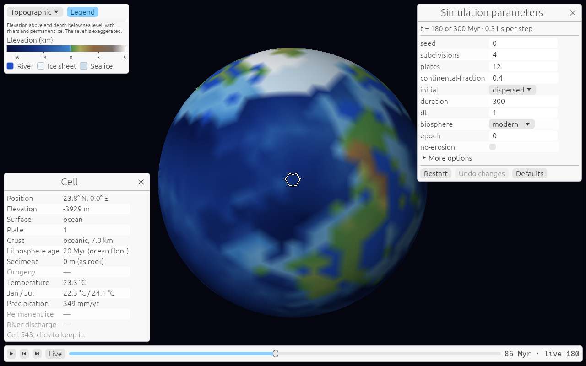
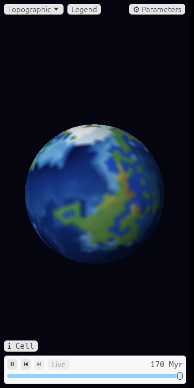

# #109 Simulation time controls: results

Plan and its review: [plan.md](plan.md).

## What changed

- **Time bar** (`src/viewer/timeline.rs`) along the bottom edge of the 3D view, desktop and web:
  pause/resume, one frame back, one frame forward (on the newest frame while paused: compute
  one more step), a slider over all recorded frames, **Live** (back to the newest state,
  following it), and the time of the shown frame ("65 Myr · live 166"). Keys: space, ←/→, End
  (the window needs keyboard focus; ignored while a text field has it). The slider's tooltip
  says how many frames are kept, where, and how large they are.
- **Viewing a past frame does not pause the simulation**: the slider keeps growing, the view
  stays on the chosen frame until Live, the last slider position or End. Pausing is separate
  (the ⏸ button). Rationale: comparing a past state with the running one needs no extra clicks,
  and a paused run is one click away.
- **Every render mode, the legend, the cell outline and the cell widget work on past frames**:
  the view rebuilds the surface from the frame's cells, and the plate-motion layer from the
  per-plate angular velocities that every update and frame now carries
  (`Fields::from_frame`).
- **The simulation no longer sends vertices**: the view builds them from the cell attributes for
  every frame (`viewer::surface_vertices`, colours via `render::surface_color`), so live and
  past frames look the same and each update is 40 bytes per cell smaller (1.6 MB at 6
  subdivisions). The mesh (directions and triangles) comes once per run.
- **Frame history** (`src/viewer/history/`): see the plan. Quantised cells (25 bytes per cell),
  byte planes, delta to the previous frame (byte-wise), `lz4_flex`, a keyframe every 25 frames.
  Desktop: an anonymous temporary file (gone with the run, also after a crash), cap 4 GB. Web:
  IndexedDB on the page, one database per run, deleted on restart; databases of closed pages are
  deleted when a page starts (Web Locks protect those of open tabs); memory fallback (256 MB) if
  IndexedDB is unavailable; cap 1 GB or the first failed write. At the cap the history stops
  recording; what it has stays viewable.
- **Pause/step**: `SimulationControl::set_paused` and `step`. Desktop: the thread waits after
  publishing a state while paused (still answering layer requests; it ends when the view drops
  its control, so restarting while paused works); it never holds the last state, so the run's
  last snapshot is written. Web: `{ paused }` / `{ step }` messages; the worker stops its step
  loop between steps. The step after a pause is not counted for the step-time hint.

## Measured sizes

`cargo test --release frame_sizes -- --ignored --nocapture` with `FRAME_SIZES_SUBDIVISIONS` and
`FRAME_SIZES_STEPS=200` (seed 0, default options; means over the second 100 steps):

| | 5 subdivisions (10,242 cells, web default) | 6 subdivisions (40,962 cells, desktop default) |
| --- | --- | --- |
| `CellInfo` as sent (56 B/cell) | 574 kB | 2.29 MB |
| quantised (25 B/cell) | 256 kB | 1.02 MB |
| keyframe (lz4) | 134 kB | 487 kB |
| delta frame (lz4) | 79 kB | 316 kB |
| **stored per frame** (1 key in 25) | **81 kB** | **323 kB** |
| 500 frames (default run) | **41 MB** | **161 MB** |
| encode a delta frame | 0.4 ms | 1.5 ms |
| decode a delta frame incl. the cells | 0.8 ms | 3.3 ms |

Seeking decodes at most 25 frames (from the keyframe); stepping forward decodes one. Worst case
about 20 ms (5 subdivisions) / 80 ms (6) on this machine; in the GUI, scrubbing at 4–5
subdivisions felt immediate. For comparison, the first estimate was 0.2–0.4 MB per frame at 6
subdivisions: the measurement is at its upper end.

Why only ~1.7× from delta over keyframe: every step changes almost every cell (plates move the
crust under the cells, erosion changes elevation and sediment, the climate changes temperature
and precipitation everywhere), so the deltas are small but noisy. Per channel at 6 subdivisions
the elevation (56 kB), sediment (43 kB), precipitation (42 kB), crust thickness (32 kB), the three
temperatures (25–27 kB each), discharge (25 kB) and age (27 kB) dominate; plate, flags, ice and
orogeny are nearly free.

Tried and not taken:
- Finer resolutions (2 m crust, 0.5 m sediment, 0.01 °C, 0.06 % discharge): delta 97 kB instead
  of 79 kB at 5 subdivisions. The resolutions now equal the cell widget's display precision
  (1 m elevation and sediment, 10 m crust (shown as 0.1 km), 0.1 °C, 1 mm/yr, 0.6 % discharge
  (shown with 3 digits), 0.25 Myr ages).
- Deflate (`miniz_oxide`, also pure Rust) instead of lz4 on the delta: level 1 65 kB, level 6
  57 kB instead of 80 kB (−20–30 %), at 3× the encoding time. Not worth a second compressor at
  these sizes; easy to swap in `codec.rs` if wanted.

## Checks

- Unit tests: quantisation within resolution (NaN, clamping, sea level stays sea level), codec
  round trips for key and delta frames, any frame from any decoded state, repeated states,
  the cap, coalesced asynchronous reads, failed writes, memory and file stores, the plate-motion
  layer rebuilt from plate rotations equals the extracted one, the time bar's forward rule.
- GUI on a virtual screen: desktop at 4 subdivisions (pause, slider, ←/→, End, a step while
  paused, plate motion on a past frame, restart while paused on a past frame); web in Chromium
  (pause, slider reading from IndexedDB, reload deleting the closed page's database, a 390 px
  wide window with the two-row bar).

## Caveats

- Past frames are quantised: the cell widget shows values at its display precision, and a
  cell within 0.6 % of the river threshold or exactly at ice share 0.5 may flip colour between
  the live state and its recorded frame (not seen in testing).
- On the web the bar and the history live on the page; pause and step take effect between
  steps of the worker (up to one step later).
- At the cap (desktop 4 GB, web 1 GB or the browser's quota) the history stops recording rather
  than thinning; at 0.3 MB per frame that is ~12,000 frames on the desktop.
- Touch-sized targets come from the existing `UiOptions` (44 pt buttons and slider height);
  tested with a narrow window, not on a real phone.

## Independent code review

A separate agent reviewed the diff. Fixed after it:
- Web: IndexedDB handlers made with `Closure::once_into_js` that never fired (the error handler
  of every successful read, the abort handler of every successful write) leaked, together with
  the request (holding up to 25 frames) or the store state. Now one write-abort and one pair of
  read handlers per run serve all requests; they find the request in their event and hold the
  state only weakly.
- Web: a run restarted while its database was still opening kept that database open (its
  deletion blocked) until the page closed; the open handler now closes it if the run is gone.
- A failed read arriving after the view went live showed an error in the time bar.
- A run paused during its last step never completed on the web (and the view's "finished" rule
  disagreed with `Run`'s `round(duration / dt)` steps); both now use the same rule
  (`is_last_step`), and the worker does not stop for a pause after the last step.
- A state sent again with other fields re-enabled → while a step was still computing.
- Flags are masked to 8 bits, keys are not taken while a drop-down list is open, pause and step
  are disabled after a failed run.
