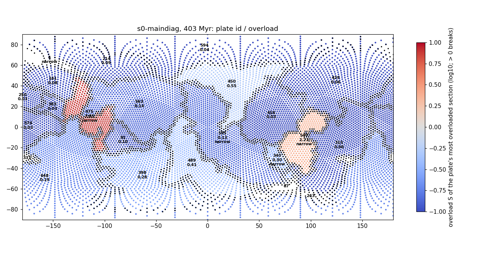
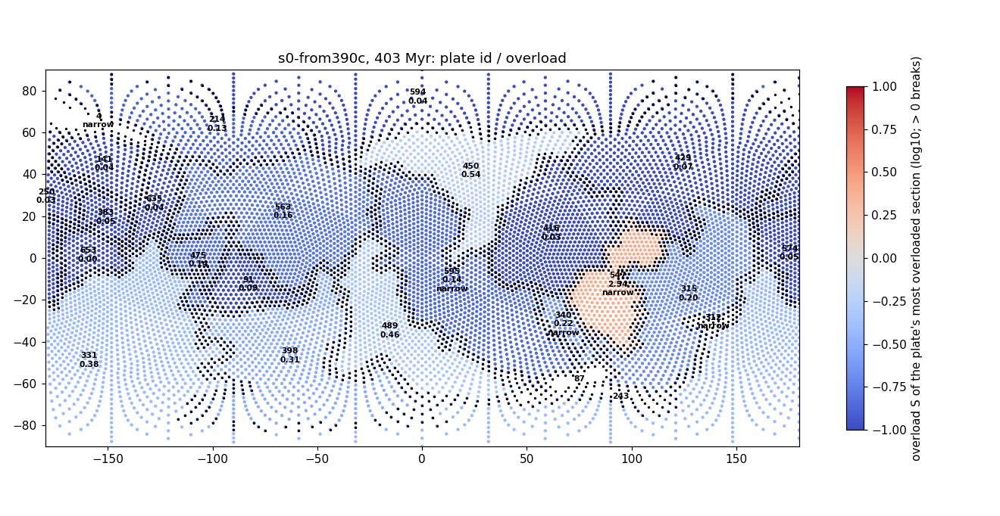

# Results: plates break where their internal stress exceeds their strength (#123)

_2026-11-26. Plan: [`plan.md`](plan.md) (revised after [`review-plan.md`](review-plan.md));
code review: [`review-code.md`](review-code.md). Goal: an Earth-like planet, not Earth;
effects of the ~110 km grid are accepted (#64)._

## Answer: can it be solved purely from the internal stress of a plate?

**Yes.** Since #70 every plate is a thin viscous sheet, but the sheet resolves stress only in
weak lithosphere; strong lithosphere (all oceanic lithosphere, cratons) moves as rigid blocks
whose internal stress it never computes, so a narrow neck in a strong plate was invisible to it.
That stress is not unknown, though: it follows from **statics**. A section that divides a plate
into parts A and B must carry the net torque of all external loads on A (the sheet's forces:
drag against the mantle at the material's velocity, slab pull and the resistances at the plate's
boundaries, ridge push, push of thickened crust). Whether the lithosphere along the section can
carry it is a **rigid-plastic limit analysis**: the overload

`S = max_ω (ω·T_A) / D(ω)`, `D = Σ F·s·ℓ·(|sliding| + opening⁺ + 3·closing⁺)`

(`F` the integrated strength of old lithosphere, `s` the relative strength
`weak_zones::lithosphere_strength`, the same that guides every other split; 3× stronger in
compression, Byerlee/Sibson). `S > 1` means the section yields. A neck of width `w` carries a
force `~F·w` but a bending moment of only `~F·w²/4`, so arms of U- and L-shaped plates and
strips break where the loads on their parts differ, **without any shape rule**. The new code
(`src/tectonics/breakup.rs`) searches each plate's sections (level sets of the distance from
three far-apart cells of the plate, refined along the weakest lithosphere by a minimum cut),
and a plate whose most overloaded section stays above its strength for 5 Myr splits there:
the smaller part becomes a new plate, the larger keeps its id and colour.

**Evidence that stress concentrates at necks** (main, i.e. breakup off, 8 seeds, 500–1000 Myr,
F = 5×10¹³ N/m): the most overloaded section of plates that are narrow (aspect ≥ 5 or a neck
≤ ~4 cells between two thicker parts) has a median overload of **0.70 (41% of them overloaded)**,
against **0.10 (5%)** for the other plates.

**Seed 0 at Sebastian's screenshot** (5 subdivisions, `--web-math`, 403 Myr): the U-shaped
plate is plate id 475 (3% of the surface, aspect 6.4, a neck one erosion step wide). Its most
overloaded section is the ~400–500 km neck: overload 1–2 at 380 Myr, 5–12 from 387 Myr on, 7.9
at 403 Myr. With breakup switched on only from 390 Myr (`--set breakup.from=390`, so that the
world is the same up to then), it breaks at 392 Myr across the neck: a 140-cell arm (34%
continental crust) splits off by opening (rifting); the rest is compact (overload 0.1–0.2).

| main (U-shaped plate 475) | breakup from 390 Myr |
|---|---|
|  |  |
|  |  |

_Plates mode at 403 Myr (snapshots of the plate render) and the plates coloured by the
overload of their most overloaded section (log scale; red breaks), with ids. Plates born after
390 Myr have other ids, hence other colours, in the right column. With breakup on from the
start (the default) the planet at 403 Myr is a different one (plate motions are chaotic):
[`img/branch-s0-sub5-plates-403.png`](img/branch-s0-sub5-plates-403.png)._

## Runs

8 seeds × 1000 Myr at 6 subdivisions, `main` = this branch with `--set breakup.enabled=0`
(bit-identical to `main`: same state hash, checked on seed 0 for 300 Myr at 6 subdivisions and
403 Myr at 5 with `--web-math`) vs the branch's defaults (commit 1418629); window 500–1000 Myr,
means over snapshots, then over seeds (seed range in brackets), Welch t. Plate maps every
10 Myr (`--plate-log 10`). Scripts: [`scripts/sim_shapes.py`](scripts/sim_shapes.py) (shapes,
narrow episodes, overloads), [`scripts/earth_plates.py`](scripts/earth_plates.py) (Earth),
`notes/realism-batch-4/scripts/compare.py` and `notes/issue-43/compare.py` (log metrics,
boundary classes).

### Shapes and sizes, against Earth

Earth: the PB2002 plates (Bird 2003) rasterised on the same 6-subdivision icosphere with the
same metrics. "Narrow": aspect (intrinsic length / mean width) ≥ 5, or two parts joined by a
neck ≤ 2 erosion steps (~4 cells, ~450 km) wide.

| | Earth (PB2002) | `main` | branch |
|---|---|---|---|
| plates ≥ 1% of the surface | 13 | 16.0 (9.1…20.2) | 18.2 (15.6…19.8) |
| plates 0.5–1% | 4 | 2.2 | 3.7 |
| plates 0.2–0.5% | 3 | 2.1 | 3.1 |
| plates ≥ 5% | 7 | 6.9 | 6.4 |
| largest plate (%) | 20.5 (Pacific) | 23.0 | 17.7 |
| aspect of plates ≥ 0.5%, median (p90) | 3.0 (4.8 max) | 3.4 (5.5) | 3.3 (5.4) |
| bend (U/L shapes: length / end-to-end distance), median (p90) | 1.14 | 1.15 (1.39) | 1.15 (1.34) |
| plates ≥ 0.5% with a narrow neck | 0 | 6.8% | 5.3% |
| narrow plates ≥ 0.5% per map | 0 | 3.31 (0.71…4.92) | 3.61 (2.76…4.45) |
| narrow episodes: duration median / mean / p90 (Myr) | Farallon: strip for ~20–30 Myr | 20 / 28 / 60 | 20 / 23 / 50 |
| most overloaded section: median overload, plates overloaded | | 0.13, 11% | 0.12, 7% |
| … narrow plates / other plates (`main`, same F) | | 0.70 (41%) / 0.10 (5%) | |
| breakups by stress per 100 Myr | | — | 2.8 (1.8…3.8) |
| … by opening (rifting) / closing (thrusting) / sliding | | | 86% / 0% / 14% |

### Model metrics (log)

| metric | `main` | branch | t |
|---|---|---|---|
| plates | 23.0 (14.1…29.5) | 28.5 (24.9…33.4) | +2.6 |
| plates > 1% | 15.9 | 18.1 | +1.4 |
| plates born per 100 Myr (other rules) | 7.3 | 7.8 | +0.5 |
| plume rifts per 100 Myr | 1.9 | 2.7 | +2.2 |
| sutures per 100 Myr | 0.70 | 0.68 | −0.1 |
| terrane accretions per 100 Myr | 11.0 | 14.8 | +1.8 |
| mean plate speed (cm/yr) | 4.20 | 4.12 | −0.3 |
| relative speed at boundaries, median (cm/yr) | 6.36 | 5.95 | −2.1 |
| boundary length (10³ km) | 275 | 304 | +1.5 |
| trenches / ridges / transforms (10³ km) | 108 / 92 / 37 | 116 / 101 / 43 | +1.3 / +1.6 / +1.3 |
| boundaries slower than 2 cm/yr (%) | 16.3 | 18.7 | +0.9 |
| continental boundaries (rift, transform, convergent) (%) | 17.5 | 19.5 | +0.8 |
| collisions (10³ km) | 38.7 | 46.4 | +0.8 |
| sea-floor production (km²/yr) | 6.0 | 6.3 | +1.1 |
| mean sea-floor age (Myr) / ≥ 200 Myr (%) | 49.0 / 1.9 | 51.6 / 2.7 | +1.6 / +1.5 |
| continental crust (% of the surface) | 34.8 | 34.2 | −0.5 |
| land (% of the surface) | 29.6 | 28.4 | −1.5 |
| mean land elevation (m) | 806 | 911 | +0.5 |
| highest cell (m) | 4062 | 4260 | +0.9 |
| flooded continental crust (%) | 23.3 | 25.8 | +0.7 |
| crust > 50 km (% of continental) | 2.3 | 4.5 | +1.0 |
| shelves (% of the surface) | 4.96 | 5.10 | +0.2 |
| collision stacking (Gt/yr) | 33.6 | 41.9 | +0.9 |
| land precipitation (m/yr) / global temperature (°C) | 1.23 / 23.1 | 1.21 / 22.9 | −0.4 / −0.4 |
| run time, 1000 Myr (s; GitHub runners) | 882 (786…949) | 854 (719…1009) | −0.5 |

### Runtime at 6 subdivisions

The analysis runs every 2 Myr (`breakup.interval`) and takes ~3.5% of the simulation's time
(6.7 s of 190 s for 300 Myr of seed 0 on tktie, side by side with `main`: 189.6 s vs 183.7 s,
+3%; the 8-seed runs on GitHub runners: 854 s vs 882 s, within noise, since the plate
configuration differs). Every step it would be ~7%. The desktop still runs 6 subdivisions at
the same speed as before for practical purposes.

## Key takeaways

1. **Stress does concentrate in narrow plates**: with the same strength, the most overloaded
   section of narrow plates carries 7× the relative load of other plates (median overload 0.70
   vs 0.10). Sebastian's U-shaped plate is the clearest case: its neck is overloaded 5–12×
   from 387 Myr on.
2. **With breakup, overloaded plates break** (2.8 per 100 Myr, mostly by rifting) and the
   plate population moves towards Earth's: more minor plates (0.2–1%: 4.3 → 6.8 per map;
   Earth 7), a smaller largest plate (23% → 18%; Earth's Pacific 20.5%), plates ≥ 5% as before
   (6.4–6.9; Earth 7). Necked plates −22%, narrow episodes end sooner (mean 28 → 23 Myr, p90
   60 → 50 Myr).
3. **Narrow plates as such do not disappear** (3.3 → 3.6 per map, within seed scatter). Most
   are long strips that are not overloaded (59% of the narrow plates on `main`): uniform slab
   pull along a trench and ridge push along a ridge load each segment of a strip alike, so it
   does not need to transmit much (like the Farallon plate, a strip for tens of Myr that broke
   up only when the loads along it changed as the ridge reached the trench). Breaks also leave
   new elongated pieces. On Earth's single snapshot no plate ≥ 0.5% is narrow by this measure;
   at ~110 km cells, strips 3–5 cells wide are near the grid's resolution (#64), and the
   aspect of small plates is inflated by the hexagonal cell steps.
4. **The rest of the model barely changes**: within seed scatter for land, hypsometry,
   collisions, sutures (0.70 vs 0.68 per 100 Myr: broken parts are not merged back), boundary
   mix, climate. More boundaries (+10%), slightly slower relative motion at them (−6%).

## Calibration

Only F (`breakup.strength`) was calibrated, 4 seeds × 1000 Myr each (earlier code with the
same physics; plates in 500–1000 Myr, `main` 21.7):

| F (N/m) | 2×10¹³ | 4×10¹³ | 8×10¹³ |
|---|---|---|---|
| plates | 36.4 | 29.0 | 28.9 |
| collisions (10³ km; `main` 28.3) | 61.9 | 46.8 | 49.8 |
| crust > 50 km (%; `main` 1.8) | 7.9 | 3.1 | 3.8 |

2×10¹³ broke plates near the 40-plate limit and doubled collision belts; 4×10¹³ and 8×10¹³
gave the same plate shapes. **5×10¹³ N/m** is kept: the upper end of estimates of the
integrated strength of old lithosphere (~10¹³–10¹⁴ N/m depending on the rheology; Kohlstedt,
Evans & Mackwell 1995; Burov 2011), matching the upper-end basal drag of the model (1.6 MPa at
5 cm/yr, ×4 under continents). Fixed, not calibrated: compression 3× tension (Byerlee), 5 Myr
overload before breaking (localisation), smallest part 0.5% of the surface (~2.6×10⁶ km²,
Cocos-sized; well above the grid), band 3 cells for the weakest path.

## Caveats

* **Grid**: sections are resolved to a cell (~110 km; ~220 km on the web's 5 subdivisions);
  necks 1–3 cells wide are near the resolution limit, and Juan de Fuca-sized microplates
  (0.05%) are below both the grid and the minimum part. Specks cannot form (0.5% minimum).
* The strength is the same proxy as for the other splits (`lithosphere_strength`, linear in
  the thermal thickness, young sea floor and orogenic belts weak); a frictional lid would grow
  ~quadratically with thickness. Breaks therefore follow young sea floor and belts.
* Sections are the level sets of distances within the plate from three far-apart points,
  refined along the weakest path: they cross strips and arms well; sections parallel to a
  trench inside a compact plate (back-arc rifts) are not searched.
* The analysed loads leave out the sheet's couplings across boundaries on the deformation;
  the plate's remaining net torque is removed as a drag-weighted rotation, as the sheet does
  (logged per section as `residual`).
* The timer counts in steps of 2 Myr, so 5 Myr of overload take 6 Myr.
* Breakup needs the sheet (`sheet.enabled=1`, the default).

## Switches

`--set breakup.enabled=0` restores `main` bit for bit. `breakup.strength` (5e13),
`breakup.compression` (3), `breakup.time` (5), `breakup.min_area` (0.005), `breakup.band` (3),
`breakup.interval` (2), `breakup.from` (0), `breakup.diagnose` (log the sections without
breaking). `--plate-log MYR` writes `plate_maps.csv` and `plate_sections.csv` for analysis.
