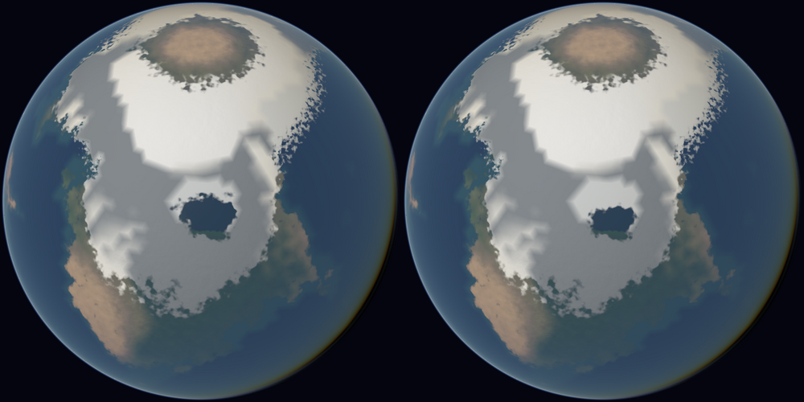
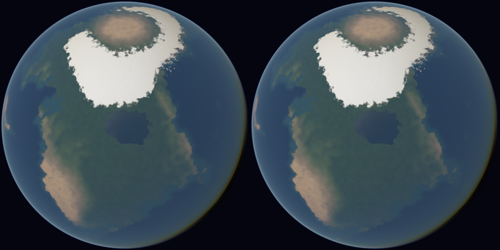
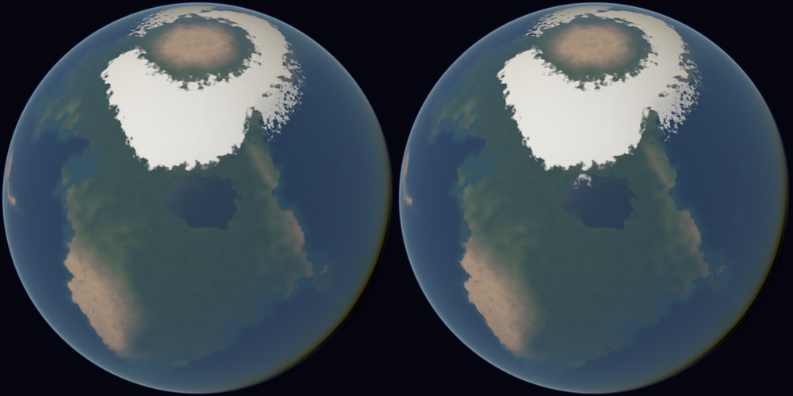
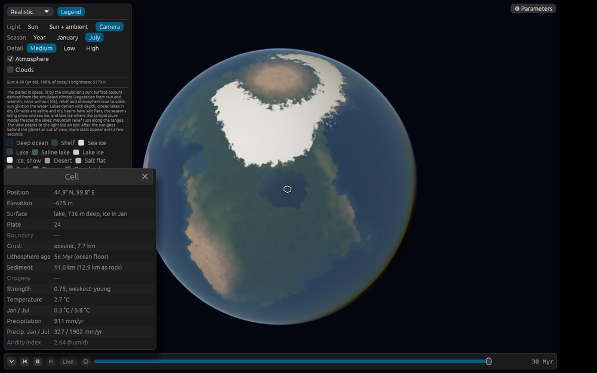
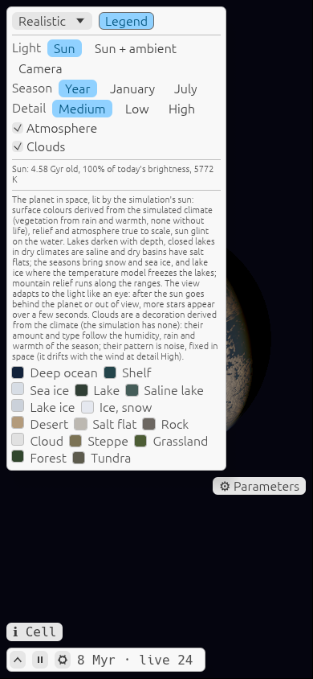

# Issue #185: results

## What changed

- **Frames carry the model's lake ice.** `CellInfo` gets `lake_ice_january` and `lake_ice_july`:
  the temperature model's mean lake-ice cover of month 0 and month 6 (the months of the
  January/July temperatures), NaN where the model has no lake. The annual cover was already in
  `ice`. The frame codec stores them as two 1-byte shares (steps of 1/254, 255 = NaN); codec
  version 11 → 12 (old frame stores are per run, nothing persists across versions).
- **Realistic mode draws lake ice from the model** (`model_lake_ice`, `lake_frozen`,
  `FROZEN_LAKE_COVER` in `src/viewer/modes/realistic.rs`):
  - January / July: frozen where the month's mean cover is above **0.1**. The model's cover is
    the ice thickness over 0.5 m (the thickness at which ice takes its full albedo), so 0.1 is
    a mean of 5 cm: a lake under thin ice all month shows as frozen. (Cover > 0.5 would leave
    lakes under 10–20 cm of ice drawn as open water.)
  - Year: frozen where the annual mean cover is above 0.5 (frozen most of the year), the
    same rule as the permanent ice of the topographic mode, the moisture mode, sea ice and the
    "Permanent ice" row.
  - The ice layer is continuous, so the shader's ice edge falls between frozen and open lakes;
    snowy vs bare lake ice as before.
  - Where the model has no lake ice (lakes as land with
    `--set temperature.open_water_lakes=0`, or a lake that appeared in the erosion step after
    the last temperature update) the old temperature rule remains as a fallback.
- **Legend:** a "Lake ice" swatch; the text says lake ice appears where the temperature model
  freezes the lakes.
- **Cell info:** the Surface row of a lake names the ice as drawn: "lake, 736 m deep, ice in
  Jan", "…, ice most of the year, open in Jul", "…, ice in Jan and Jul"; nothing where the model
  has no lake ice.
- Unchanged: the ≥ 1 m rule (closed depressions with less water are land) and the model's
  temperatures of lakes below sea level (`lake_air` only fills dry depressions). The other modes
  already used the model's annual ice.

## Tests

- `the_lake_ice_drawn_is_the_temperature_models` (planet, 4 subdivisions, seed 0, 20 Myr): on
  every cell that is a lake in the view and in the model, the lake is drawn frozen exactly where
  the model's cover passes the threshold, in the year, January and July, live and after the
  frame codec (within half a quantisation step); cells carry lake ice exactly on the model's
  lakes; some lakes are frozen and some open in a month.
- `lakes_freeze_where_the_temperature_model_has_lake_ice`: the model wins over the
  temperatures (a mild lake the model freezes is frozen, a cold one it leaves open is open), the
  0.1 edge, the layer agrees with `lake_frozen` for every cover, fallback without model data.
- Cell info Surface text; codec round trip (with changing values, so the delta path is used).
- fmt, clippy (native, all targets and features; wasm32), `cargo doc`, all 521 tests pass with
  warnings denied.

## Frame size

`frame_sizes` test, 5 subdivisions (10 242 cells), 100 steps, second half:

| | before | after | change |
| --- | ---: | ---: | ---: |
| raw quantised frame | 563 694 B | 584 178 B | +3.6% (55 → 57 B/cell) |
| key frame (lz4) | 318 585 B | 318 748 B | +163 B (+0.05%) |
| delta frame (lz4) | 135 364 B | 135 550 B | +186 B (+0.14%) |
| stored per frame (1 key in 25) | 142 693 B | 142 878 B | **+185 B (+0.13%)** |
| `CellInfo` in memory | 140 B/cell | 148 B/cell | +5.7% |

The two lake-ice channels cost 83 + 86 B per delta frame: off the lakes they are a constant
NaN.

## Screenshots

Desktop viewer on a virtual screen, `--subdivisions 5 --seed 1 --duration 30 --render-mode
realistic`, clouds off, camera light, at 30 Myr; a large lake system at 40–50° N, 86–108° E
(the same state before and after: equal state hashes). Left before (main), right after.

- January: before, the deep southern part of the lake (Jan mean −2…+1 °C, model cover
  0.13–0.26, i.e. 6–13 cm of ice on average) was open by the viewer's own rule; after, it is
  frozen as in the model. The part still open has a model cover below 0.1.
  
- July: open in both (the model has no lake ice in July there).
  
- Year: the main lake is open in both (annual cover up to 0.47, frozen less than half the
  year); after, a small bay at its northern tip, which the model keeps frozen most of the year,
  shows ice.
  
- Cell info in July over a lake the model freezes in January (cover 0.17, Jan +0.3 °C):
  "lake, 736 m deep, ice in Jan".
  
- Web, phone size (390×844), legend open: the new "Lake ice" swatch and text fit; panels and
  touch layout unchanged.
  

## Caveats

- **Coarse grid (accepted, #64):** all lakes in one coarse cell of the temperature model (~440 km,
  16 fine cells at 6 subdivisions) share one lake column with their mean depth, so a deep and a
  shallow lake close together freeze alike; the old rule froze deep lakes later. Lake ice
  cover is a coarse-cell value interpolated to the fine lake cells.
- A monthly mean cover can be > 0.1 with a mean surface temperature slightly above 0 °C
  (ice for part of the month, open water later); the picture follows the cover.
- A lake that formed in the latest erosion step has no model ice yet: it is drawn by the old
  rule for one step, and the cell info makes no ice claim for it.
