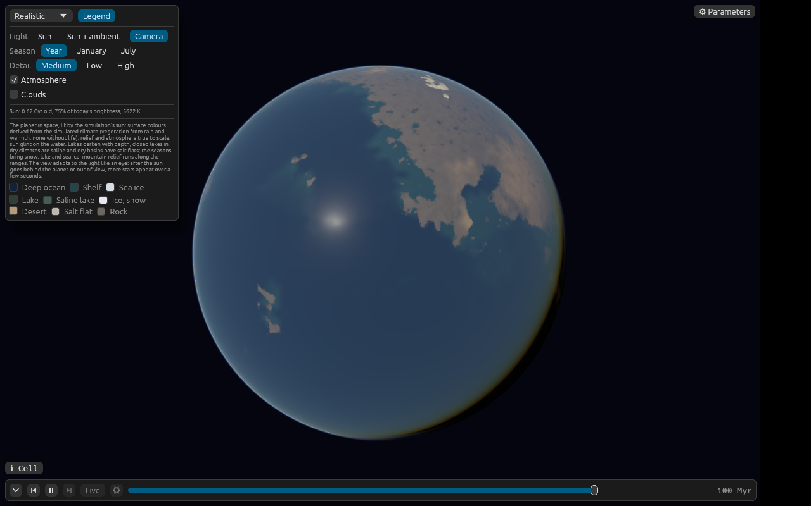
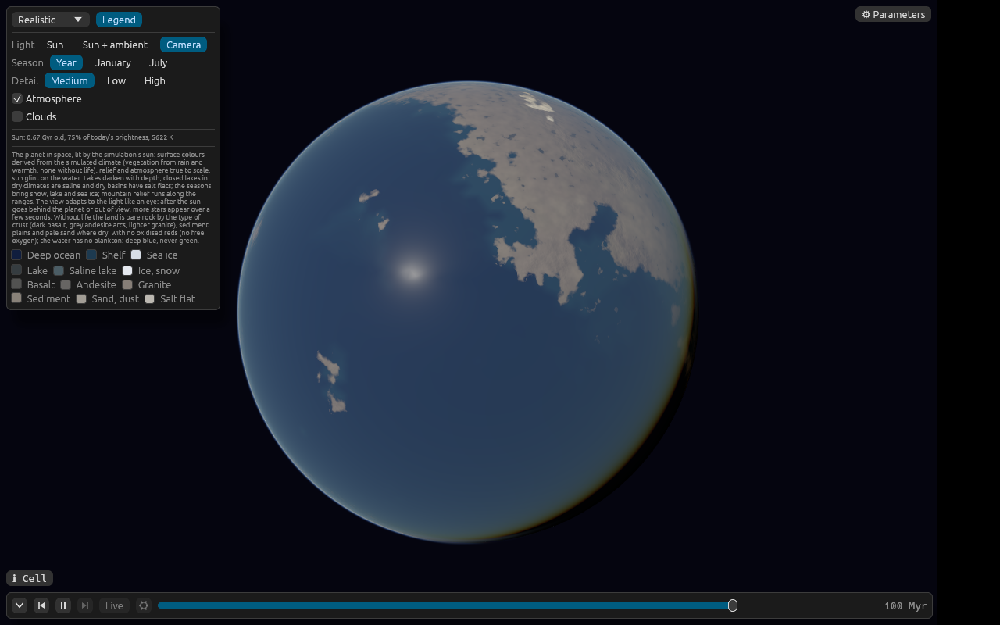
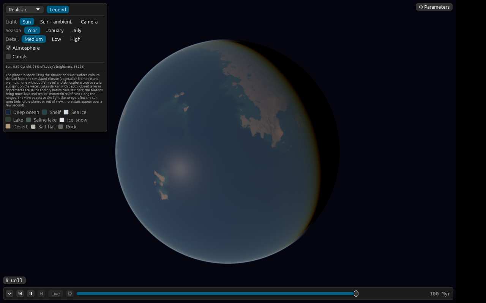
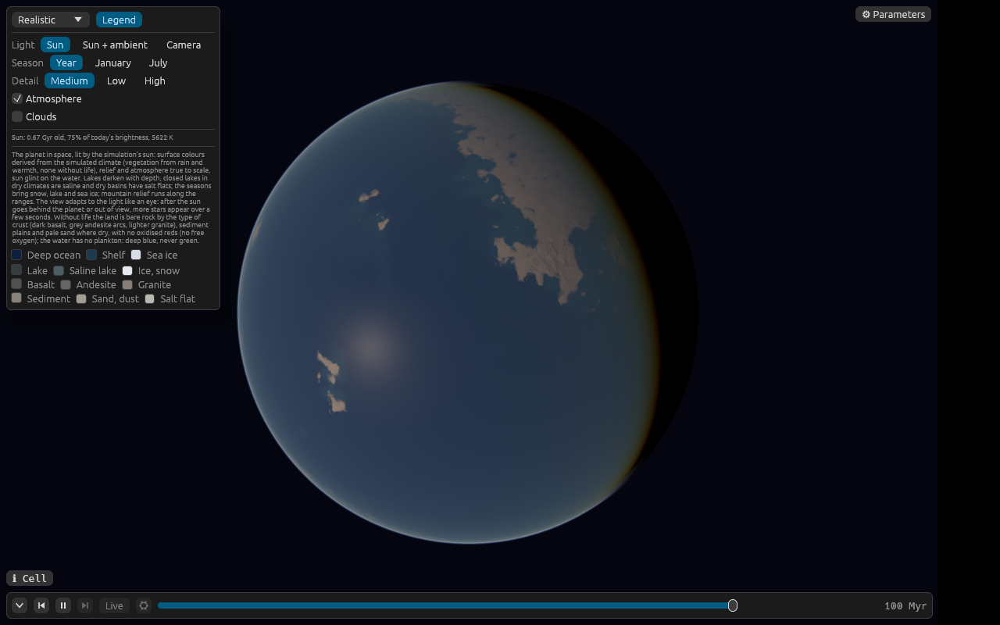
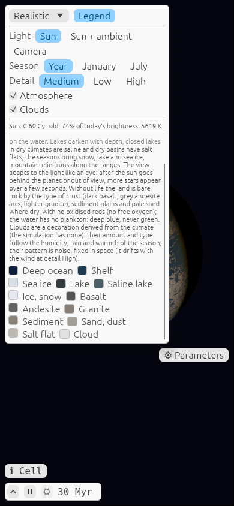

# #190 / PR #193: the Realistic view of a barren planet (plan and result)

Sebastian's decision 1 on PR #193: "The realistic mode should realistically render how a barren
earth-like planet looks like."

## What the view draws today for `--biosphere abiotic` (#92)

`src/viewer/modes/realistic.rs::layers` already turns off vegetation and tundra when
`abiotic` is set. Everything else is the living planet's palette:

| Surface | Today (abiotic = living) | Problem for a barren planet |
|---|---|---|
| Bare land | `mix(mix(ROCK, SOIL, 0.5), SAND, arid)`: one brownish-pink regolith everywhere, orange sand where arid | `SOIL` is organic soil; `SAND` (0.45, 0.33, 0.20) is the reddish hue of hematite-coated desert sand, which needs free O₂. The crust type is ignored: basalt islands and granite shields look the same. |
| High mountains | blend to `ROCK` | ok, but should be the crust's own rock |
| Shelf | (0.018, 0.060, 0.070), turquoise | the green comes from phytoplankton/CDOM and bright carbonate (biogenic) sand |
| Deep ocean | (0.006, 0.016, 0.042) | mostly fine; pure water is a little bluer |
| Lakes | shallow (0.030, 0.050, 0.035) greenish turbid, deep (0.009, 0.021, 0.028) | the green is algae/humic matter |
| Saline lake | (0.060, 0.110, 0.100) green | colour of saline lakes on Earth comes from algae/halobacteria |
| Salt flat, ice, snow, sea ice | | abiotic, unchanged |
| Clouds, atmosphere | | unchanged (cloud brightness without biogenic nuclei is #204) |

## What a barren Earth-like planet looks like

- **No life, so no free O₂** (abiotic O₂ is 10⁻¹³–10⁻⁷ PAL, see #201): no red beds, no
  hematite-reddened deserts, no organic (dark) soils. Iron stays ferrous; weathering makes grey
  and greenish-grey clays. Surfaces are **greys, grey-browns and buff** (cf. the Moon, Iceland's
  lava fields, Antarctic dry valleys, lunar/Martian regolith without Mars's oxidation).
- **Rock types:** basalt (oceanic crust, arcs on mafic basement, oceanic plateaus): dark grey,
  albedo ~0.08–0.12. Granite/gneiss (felsic continental crust): light grey-brown with a pink
  hint from K-feldspar, ~0.2–0.3. Metasediment (schist, greywacke): medium grey, ~0.15.
- **Regolith and sediment:** fine-grained regolith is brighter than the fresh rock it comes
  from; sediment plains (silt, sand from felsic crust) ~0.22–0.28; dry sand and dust
  (quartz–feldspar, unoxidised) buff ~0.3–0.35.
- **Water:** without phytoplankton and dissolved organics, open water is the colour of pure
  water: deep blue, slightly violet. Shallow water over terrigenous sediment is a lighter,
  cyan-blue, not green. Lakes on bare land are turbid with rock flour and silt (grey-cyan),
  deep lakes clear blue. Shallow brine over salt: pale cyan.
- Ice and snow stay white.

## The change (no frame growth, no shader change)

All data is already in every frame (live and history): the crust flags `CONTINENTAL`,
`OCEANIC`, `FELSIC`, `METASEDIMENT` (low 16 bits, kept by the history), `crust_thickness`, the
land `sediment` (rock-equivalent m), elevation, moisture index. `CrustType::of` already
classifies them. The shader mixes `bare`/`plants`/`snow`/`water` layers; only the CPU colours
change.

1. A `Palette` of water colours (deep ocean, shelf, lake shallow/deep, saline lake) with a
   `LIVING` constant (today's values, so `--biosphere modern` stays bit-identical) and a
   `BARREN` one; `layers` picks by `abiotic`. Barren (linear RGB):
   - deep ocean (0.005, 0.013, 0.048), shelf (0.012, 0.042, 0.080),
   - lake shallow (0.035, 0.045, 0.052) grey-cyan turbid, lake deep (0.006, 0.014, 0.042),
   - saline lake (0.070, 0.110, 0.130) pale cyan.
2. Bare ground when abiotic: `barren_ground(cell, arid, high)`:
   - rock by `CrustType`: oceanic / mafic transitional / mafic continental → basalt
     (0.085, 0.085, 0.082); continental / thick / thinned continental → granite regolith
     (0.24, 0.21, 0.185); metasedimentary → (0.16, 0.155, 0.15);
   - sediment cover on top: `smoothstep(20, 400, sediment)` towards sediment plain
     (0.25, 0.225, 0.19) (sediment on mafic crust stays a bit darker: it is the
     same mix);
   - arid → buff sand and dust (0.38, 0.33, 0.26) as today with the moisture index;
   - high mountains → the crust's fresh rock (darker than its regolith: basalt
     (0.07, 0.07, 0.07), granite (0.20, 0.18, 0.165)) instead of `ROCK`.
   Salt flats unchanged. Sub-cell lakes on land and coast neighbours take the barren lake and
   ground colours through the existing code paths.
3. Legend: when abiotic, the swatches show the barren palette: Deep ocean, Shelf, Sea ice,
   Lake, Saline lake, Ice/snow, Basalt, Granite, Sediment, Sand/dust, Salt flat (+ Cloud).
   Description: one sentence on bare rock by crust type and water without life.
4. Tests: living palette unchanged (existing tests); barren: no colour has green above both
   red and blue... precisely: for every barren surface `g <= max(r, b)` and land greenness
   < 0.36; basalt darker than granite; ocean deep is bluest; arid brighter than humid;
   brightness in the ranges above.

## Physical caveats (for the PR)

- The physics uses one land albedo (0.37) for the barren planet; the view's colours vary with
  the rock (0.08–0.35), so a basaltic island looks darker than the model makes it. The view is
  the more realistic of the two; a per-rock albedo in the physics would be a separate issue.
- Volcanism, fresh lava, impact craters and dust storms are not drawn (not modelled).
- At ~110 km (220 km on the web) a cell is one rock type; real surfaces mix them below the
  grid. The sub-cell noise varies brightness only.
- Turbid river plumes on the shelf are not drawn (no per-cell suspended load in the frames).

## Review (independent agent) and what changed after it

- NaN sediment would blacken a cell: guarded (falls back to 0 m), tested.
- The sub-cell lake colour on land was a hard-coded constant: now from the palette, tested.
- Unoxidised sand is pale greyish buff, not yellow (that colour is goethite/hematite coatings,
  which need O₂): `DUST` (0.36, 0.335, 0.30); sand from mafic crust is dark (`MAFIC_SAND`, black
  sand), and a basaltic desert stays dark (rock desert).
- Arcs and thickened crust on a mafic basement are andesite (0.135, 0.13, 0.125), not basalt;
  basalt only for oceanic crust.
- Sediment threshold checked against a frame (seed 1, 5 subdivisions, 100 Myr): land sediment
  percentiles 50% 0 m, 75% 27 m, 90% 632 m, 97% 2.9 km, so `smoothstep(20, 400)` covers the
  basins (~15–20% of the land) and leaves the rock showing elsewhere.
- Living look bit-identical: the living code path keeps its operations and constants
  (`Waters::LIVING` holds the old constants). Verified by rendering `--biosphere modern
  --epoch 4` with the old and the new binary on the virtual screen: the screenshots are
  pixel-identical.
- Barren fresh rock replaces `ROCK` in both the `bare` and `plants` layers (tested).
- Legend and module docs describe the barren palette when abiotic.
- Caveat noted: some work suggests anoxic, iron-rich early oceans could look greenish from
  Fe(III) particles made by UV photo-oxidation; clear blue is the default here (no iron
  chemistry in the model).

## Result

Seed 1, 5 subdivisions, 100 Myr, default (barren) run, clouds off, desktop viewer:

| | before | after |
|---|---|---|
| Camera light |  |  |
| Sun (default light) |  |  |

Web at phone size (390×844), legend scrolled to the new swatches:

- Land: one pinkish-tan regolith (with orange sand where dry) → grey-brown granite regolith
  on the continents, dark basalt/andesite where land is on mafic crust (oceanic islands,
  arcs), sediment plains in basins, pale grey-buff sand in deserts.
- Shelves: turquoise → cyan-blue; deep ocean a little bluer; lakes grey-cyan (shallow) to
  clear blue (deep), no green.
- At this time almost all land is felsic continental crust (99% of land cells at 100 Myr), so
  most of the land is granite-coloured; basalt shows on the few volcanic islands. At ~110 km
  (220 km on the web) a cell is one rock type; real surfaces mix rocks below the grid, which
  the sub-cell noise only hints at by varying brightness.
