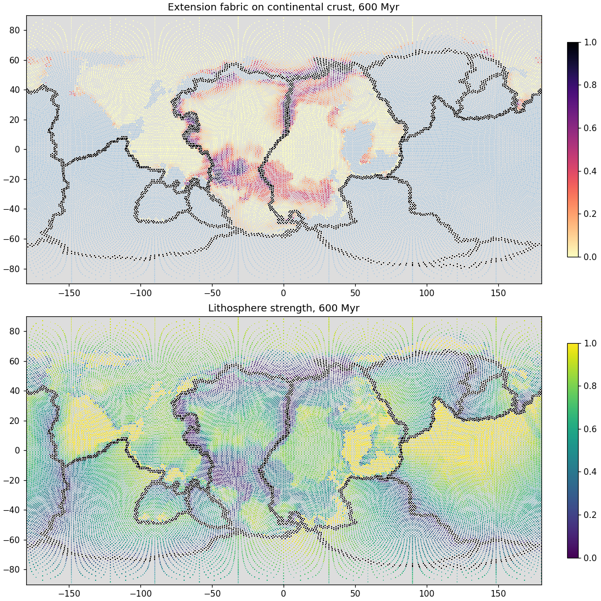

# Results: plume rifts from physics only (#51) and extension fabric / failed arms (#54)

_2026-11-27. Plan: [`plan.md`](plan.md) (revised after [`review-plan.md`](review-plan.md)).
Independent evaluation: [`review-results.md`](review-results.md). Goal: an Earth-like planet,
not Earth; effects of the ~110 km grid are accepted (#64)._

## Short answer

* **With literature values, the physics alone does not rift plates at plumes.** Plume rifts
  (splits within ~500 km of a plume) fall from 2.8 to 0.8 per 100 Myr, which is the chance rate
  (0.6 per 100 Myr pass that close to the plumes' *antipodes*). Plume sections are rarely
  overloaded: in 2 600 analyses of plates with a plume (4 seeds × 400 Myr), the best section
  through the plume was overloaded (S ≥ 1) 13 times, and no plate broke along one. The swell's
  push and the magma act only on the head's ~2000 km chord of a plate-wide section, so they lower
  a whole section's strength by a factor of ~1.5, not 10 (as the plan review predicted).
* **Consequence:** fewer plates and larger ones. 500–1000 Myr: plates 27 → 20, largest plate
  19% → 36%, births 10.9 → 7.2 per 100 Myr (all |t| ≥ 3). The supercontinent cycle does not get
  better or clearly worse: neither arm disperses a supercontinent within 500 Myr.
* **#54 works as intended:** stretching leaves an extension fabric that weakens the lithosphere
  for ~200 Myr. Later breakups follow it: on new boundaries 25% of the continental cells carry
  fabric against 11% of the split plates (2.3×); fabric deep inside continents (failed rifts,
  aulacogens) 14% against 8% (1.8×). Over 1000 Myr, 55% of the sheet's shortening falls on fabric (1–96% by seed): rifts are inverted, partly because deforming zones alternate between stretching and shortening.
  The fabric forms broad patches over stretched regions, not narrow arms (grid, #64).

**Decision for Sebastian** (the threshold fixed in the plan, ≥ 1 plume rift per 100 Myr above
chance, was missed): see [Decision](#decision).

## What changed

1. **Swell load** (`sheet.rs::cell_forces`, `MantleFlow::plume_swell_gradient`): the potential
   energy of the plume swells, `ρ_m g h L` with the dry swell height `h` (≤ 650 m) and the
   lithosphere's thickness `L` (100 km × its thermal term), pushes the lithosphere away from the
   swell's crest, in the sheet and in #182's loads. Peak ~2 × 10¹² N/m, like ridge push.
2. **Magma-assisted opening** (`weak_zones::magma_weakening`): where a plume supplies melt now
   (the head's footprint during its first 20 Myr, the tail's later, scaled by the flux), the
   lithosphere's strength in **opening** is × 0.1 (Buck 2004, 2006; Bialas et al. 2010), floored at
   the ridge-axis strength 0.05. #182's limit analysis now has separate strengths per section
   edge for opening, sliding and closing (per-edge IRLS weights; convex; tested). The sheet's
   viscosity gets the same factor (isotropic; capped by its viscosity floor).
3. **Sections through plumes** (`breakup.rs::plume_sections`): great circles through each active
   plume above a plate, 6 orientations, the side next to the plume connected; the best is
   analysed fully and refined along the weakest lithosphere like the level sections.
4. **Plume-rift rule removed:** `rift_above_plumes`, `SplitAnchor::Rift`, the nucleation lines
   (`SPINE_LENGTH`, `RIFT_ORIENTATIONS`), `rift_delay`, `min_oceanic_rift_area`,
   `Plume::has_rifted` and the rift-only statistics. `--set events.rift_delay=…` and
   `events.min_oceanic_rift_area` no longer exist.
5. **Extension fabric** (`Crust::rifted`, #54): grows with the extensional strain of continental
   lithosphere (sheet stretching at ≥ 10⁻¹⁵ s⁻¹, so creep noise does not add up; boundary rifts
   that stretch margins, `stretch_rift`), full at a strain of 1; mixed by mass like the orogenic
   weakening (continental lithosphere only), heals with it (200 Myr). Weakens the strength by up
   to × 0.5 (`RIFT_FABRIC_WEAKENING`: the mechanical part of a rift's weakness; the thermal part
   and the thinning are separate terms) in `lithosphere_strength` (#182, weak-zone cuts, view) and
   in the sheet's strength. Strength view: new "Rift fabric" term and "Rifted margin, failed
   rift" weakness; frame history format version 12 (one more 8-bit channel); `--cell-dump`
   column `rifted`.
6. **Diagnostics** (also on the baseline, state unchanged): per new boundary its cause, distance
   to the nearest plume and to the nearest plume antipode (chance null), and the belts and
   fabric on it; per snapshot the fabric area (near margins / deep inside continents) and the
   share of the sheet's shortening on fabric; #182's plume-section overloads. `births()` now
   counts #182 and sheet splits (it missed them on main).
7. Ablation switches (physical defaults, for attribution): `--set swell_load=0`,
   `magma_weakening=1`, `rift_fabric=0`.

## Runs

* `base`: main (1418167) + the diagnostics only (the tree of this branch's first commit c77fad9) (same state hash as main,
  checked on seed 0 at 0/50/100 Myr). `new`: this branch (42f8aab, the code of the runs). `nofabric`: the branch with
  `--set rift_fabric=0` (4 seeds).
* 8 seeds × 1000 Myr, 6 subdivisions, main's default flags (dispersed start, no `--epoch`),
  `--snapshot-interval 10`. Supercontinent arms: `--initial supercontinent`, 4 seeds × 500 Myr.
  Step 0: the branch before the removal with the rule switched off, 4 seeds × 400 Myr.
* Means over snapshots in the window (rates: differences of the cumulative counts), then over
  seeds (range in brackets), Welch t against `base`. Script:
  [`scripts/compare.py`](scripts/compare.py); map: [`scripts/fabric_map.py`](scripts/fabric_map.py).

### Splits and plates, 500–1000 Myr (per 100 Myr)

| | base (main) | new | nofabric |
|---|---|---|---|
| plume-rule rifts | 2.25 [1.6–2.8] | 0 | 0 |
| #182 breakups by opening | 1.88 | 1.80 (t −0.2) | 1.20 |
| #182 by sliding/closing | 0.65 | 0.33 (t −1.7) | 0.00 |
| sheet splits | 0.68 | 0.45 | 0.20 |
| subduction initiations | 4.80 | 4.33 (t −0.9) | 3.75 |
| all splits | 10.25 | 6.90 (t −4.6) | 5.15 (t −4.8) |
| splits ≤ 500 km of a plume | 2.83 | 0.78 (t −7.3) | 0.90 |
| … of a plume's antipode (chance) | 1.32 | 0.60 | 0.50 |
| splits ≤ 1000 km of a plume | 3.30 | 1.20 | 1.00 |
| … of an antipode | 1.82 | 1.05 | 0.55 |
| opening breakups ≤ 500 km of a plume | 0.15 | 0.05 | 0.10 |
| breakups along a plume section | — | 0 | 0 |
| births / deaths | 10.9 / 11.1 | 7.2 / 7.6 (t −4.6 / −3.2) | 5.3 / 5.2 |
| plates | 27.2 [20.7–35.8] | 20.4 [16.6–23.9] (t −3.3) | 15.0 (t −6.1) |
| largest plate (% of surface) | 19.3 | 35.9 [19.9–57.4] (t +3.6) | 40.8 (t +7.1) |

0–500 Myr: plume rifts 2.52 → 0; splits ≤ 500 km of a plume 2.92 → 0.93 (antipodes 0.90 →
0.70); all splits 11.3 → 9.3 (t −1.8); plates 25.4 → 21.9 (t −2.0); largest plate 18.8 →
24.1% (t +2.7). The effect grows with time: the plates that the rule used to split stay whole
and grow.

In step 0, the overload of the best section through a plume per analysed plate (4 seeds,
0–400 Myr, 2 600 analyses): < 0.25 in 86%, 0.25–0.5 in 6%, 0.5–1 in 2%, ≥ 1 in 0.5%.

### Continents, land and deformation, 500–1000 Myr

| | base | new | nofabric |
|---|---|---|---|
| continental crust (% of surface) | 34.6 | 35.9 (t +1.4) | 36.7 |
| crust of continental origin | 37.9 | 40.3 (t +1.9) | 39.4 |
| land | 29.6 | 29.1 (t −0.8) | 32.0 |
| mean land elevation (m) | 804 | 589 (t −1.5) | 555 |
| flooded continental crust (%) | 23.9 | 30.0 (t +2.3) | 21.1 |
| continental crust > 50 km (%) | 2.2 | 1.3 (t −0.8) | 0.2 |
| largest continental mass (% of continental crust) | 91.0 | 91.3 (t +0.1) | 98.7 |
| land masses (without specks) | 15.0 | 18.1 (t +1.7) | 13.3 |
| deforming area (≥ 10⁻¹⁶ s⁻¹, % of surface) | 8.2 | 5.5 (t −1.6) | 2.5 |

0–500 Myr: no difference beyond |t| = 1 in continental area, land, elevation, flooding, thick
crust or deformation.

### Supercontinent

The default start is dispersed; on both arms the continents assemble within the first few
hundred Myr into one mass of ~90% of the continental crust (largest mass ≥ 98% at some point
after 100 Myr on every seed) and stay mostly together; the largest mass fell below 35% on 2 of 8
base seeds (at 80 and 130 Myr, reassembled ~100 Myr later) and on 1 of 8 new seeds (briefly, at
250–290 Myr). From a supercontinent start
(4 seeds × 500 Myr) neither arm disperses it: the largest mass, every 50 Myr:

| seed | base | new |
|---|---|---|
| 0 | 100 100 72 71 69 69 69 99 99 100 99 | 100 100 77 76 76 76 99 99 98 98 98 |
| 1 | 100 93 93 86 86 94 93 99 99 99 99 | 100 93 88 88 91 92 100 100 100 100 100 |
| 2 | 100 100 100 59 59 61 92 93 92 92 99 | 100 100 100 99 99 99 99 99 99 99 99 |
| 3 | 100 100 99 98 92 92 94 95 95 94 94 | 100 100 92 99 100 100 99 100 100 99 100 |

Main splits a large piece (≥ 25%) off the supercontinent in 2 of 4 seeds, the branch in 1 of 4;
plates 23.0 → 15.9 (t −5.1), largest plate 20 → 36% (t +3.2) over 0–500 Myr. Main's
supercontinent cycle is weak already (the archive notes slow breakup); removing the plume rule
weakens it further, mainly by leaving the supercontinent's plate whole. (The "largest mass"
counts continental crust that touches across plate boundaries as one; a supercontinent split
into plates that have not yet drifted apart still counts as one.)

### Extension fabric and failed arms (#54)

| | 0–500 Myr | 500–1000 Myr |
|---|---|---|
| mean fabric on continental crust | 0.06 | 0.09 |
| continental cells with fabric ≥ 0.25 near margins / deep inside | 3.9% / 4.4% | 3.5% / 8.7% |
| new boundaries: continental cells on fabric vs in the split plates | 17% vs 6% | 25% vs 11% |
| … on fabric deep inside continents | 6% vs 3% | 14% vs 8% |
| … on orogenic belts, base / new | 19 / 17% vs 13 / 10% | 58 / 39% vs 39 / 24% |
| sheet shortening on fabric (cumulative over 1000 Myr, mean of 8 seeds) | | 55% [1–96%] |

* Later breakups reactivate fabric 2–3× more often than chance, and interior fabric (failed
  rifts, aulacogens) ~2× (the plates' own share is the chance level). Sutures and belts are
  still followed (belts on boundaries 1.6× their share).
* Without the fabric (`nofabric`) the branch has even fewer splits (5.2 per 100 Myr) and
  plates (15): the fabric partly makes up for the lost plume rifts, as weak zones that #182 and
  initiations break along.
* The sheet stretches the plume heads only a little: oceanic heads stay rigid, continental
  ones are capped by the viscosity floor. Most fabric comes from stretching in the deforming
  continental interiors (behind collisions, across wide rifts) and from boundary rifts. It forms
  broad patches over the stretched regions rather than narrow arms: radial push on a nearly
  uniform sheet stretches a disc, and the grid (~110 km) smears a 50–100 km graben over 1–3
  cells (#64). Map (seed 0, 600 Myr; plate boundaries black):

  

### Runtime

Paired local runs, one core, 200 Myr, seed 0: 119.2 s (base) vs 119.8 s (new), +0.5%; the
section analysis 4.2 → 5.7 s (sections through plumes).

## Decision

The plan fixed the threshold in advance (≥ 1 plume rift per 100 Myr above chance). It was
missed: with the swell's push, magma-assisted opening at Buck's factor and sections through the
plumes, plates do not break at plumes. This matches the plan review's estimate: the plume acts
on ~2000 km of a section that crosses the whole plate, and the limit analysis needs the whole
section to yield. In nature, plume rifts *propagate*: a magma-filled rift tip concentrates stress
and cuts the plate segment by segment (Buck 2006; the Afar and Red Sea rifts), which a
rigid-plastic analysis of a whole section cannot represent.

Options:

1. **Accept physics only** (this PR as it is): no plume rifts; fewer (20 vs 27) and larger
   plates; the supercontinent stays together longer; #54's fabric in.
2. **Keep the plume rule** alongside the new physics: revert the removal commit (the swell load,
   magma weakening, plume sections and fabric stay). Plume rifts as on main, still by the
   nucleation lines (#51 stays open as the cleaner formulation).
3. **Model rift propagation** as a stated physical assumption: e.g. magma channelled along an
   opening section from the plume (the review's suggestion), applying the magma factor along the
   whole propagating rift instead of only over the head. That is a new model with its own
   parameter (how far melt propagates), not a literature constant; it would need its own plan.

No knob was tuned: `magma_weakening` 0.1, `swell_load` 1 and `rift_fabric` 1 are physical
defaults; the switches exist for the ablation.
