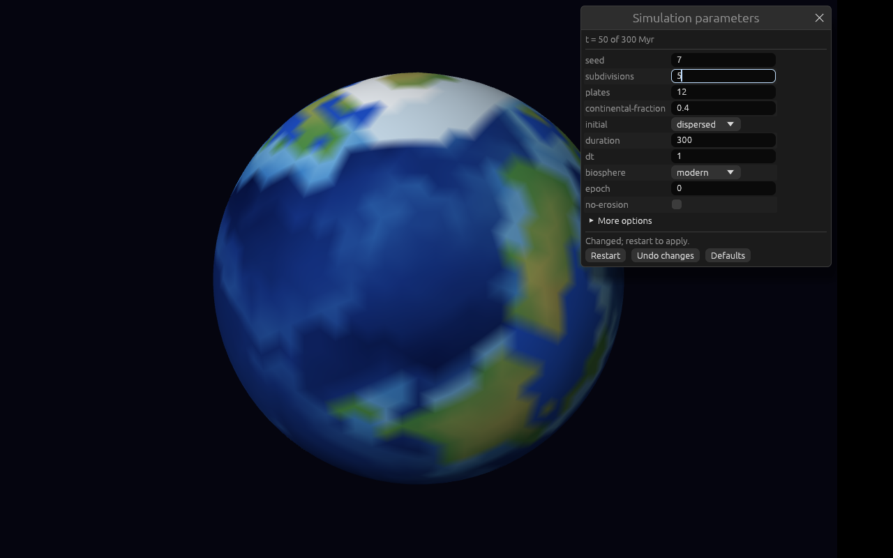
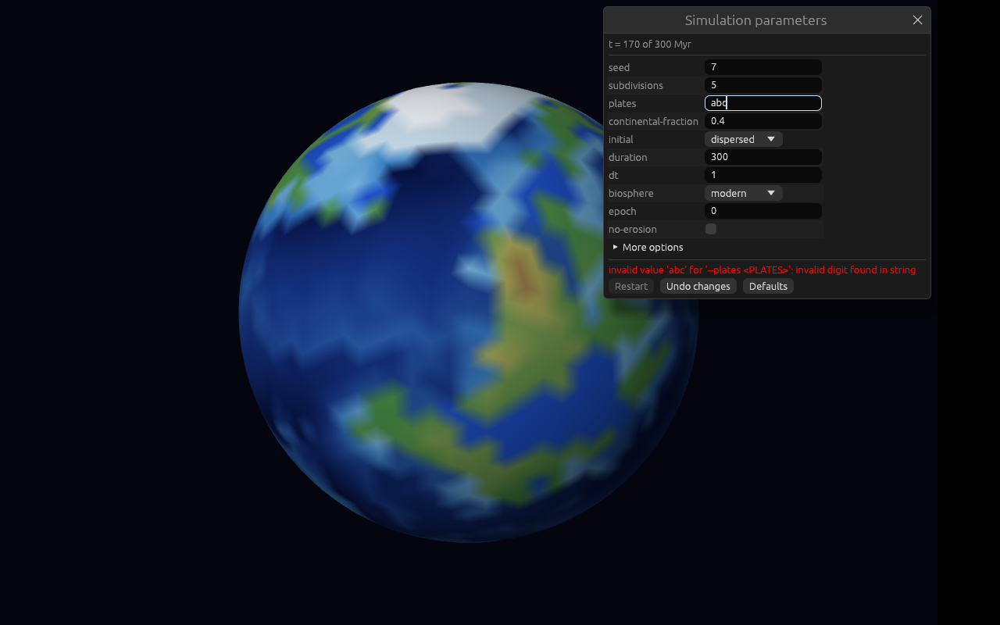
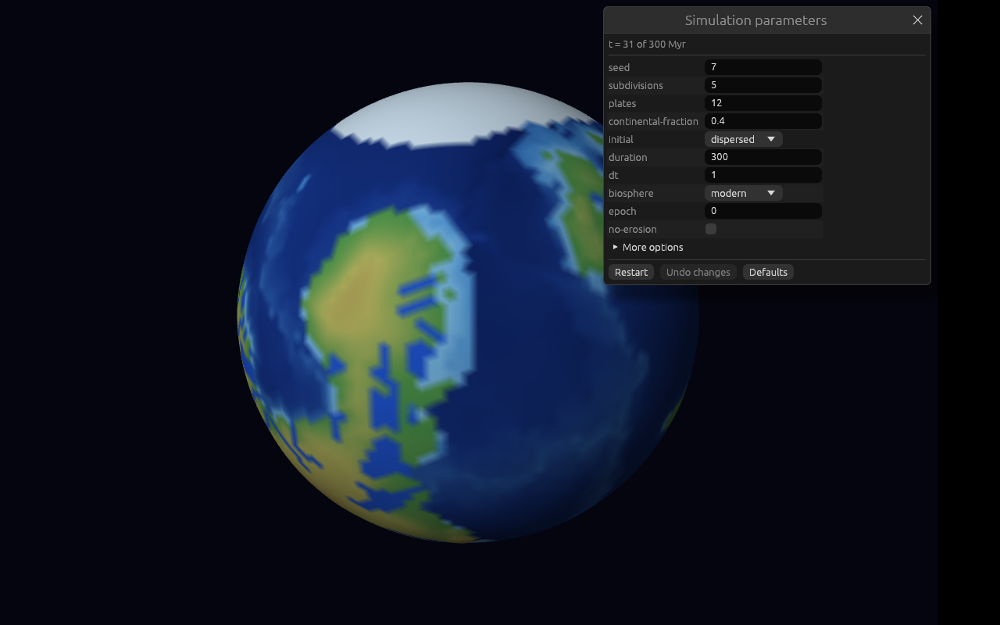
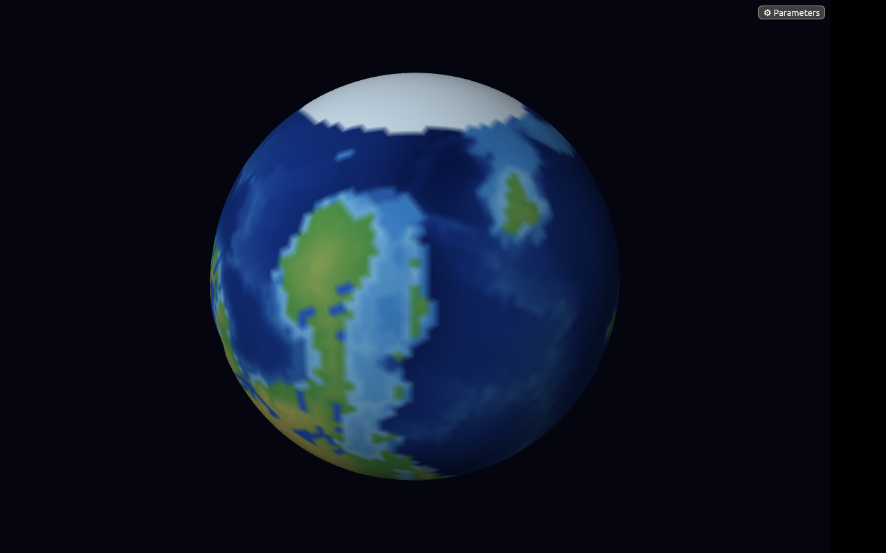
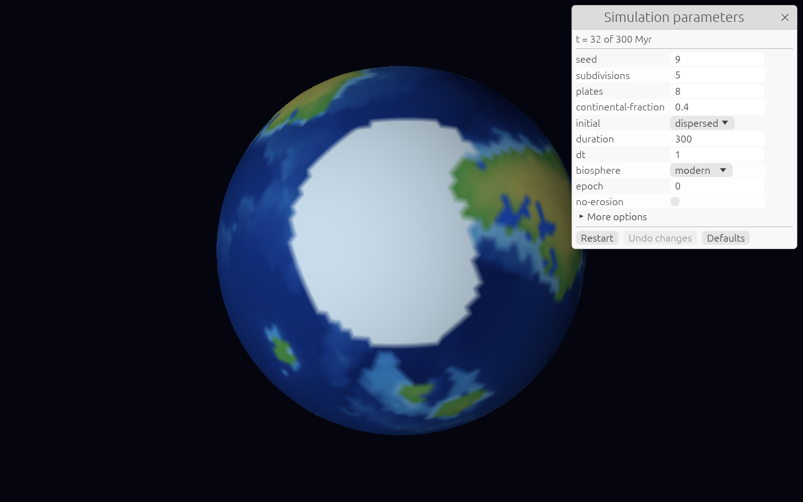
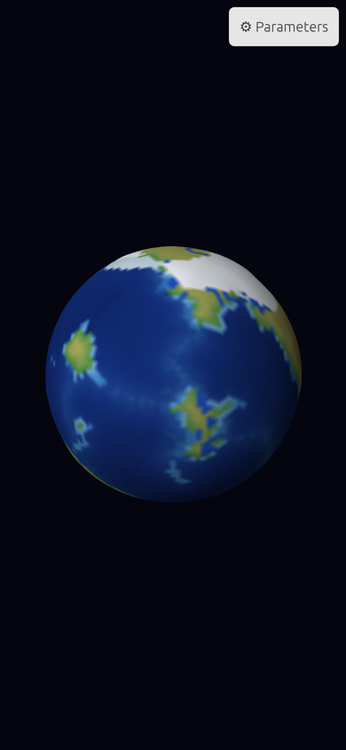
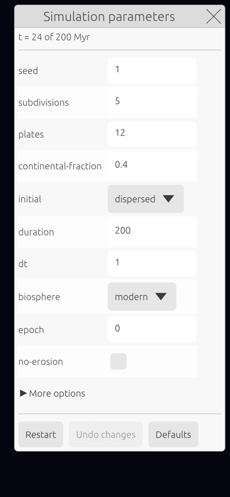

# Issue #61: parameter panel: results

Implements [plan.md](plan.md). All tests on tktie, 2026-11-21.

## What it looks like

| | |
| --- | --- |
| Desktop, edited values ("Changed; restart to apply") |  |
| Desktop, an invalid value: the clap message, Restart disabled |  |
| Desktop, after Restart with seed 7 and 5 subdivisions (finer mesh) |  |
| Desktop, hidden: only the "⚙ Parameters" button |  |
| Web (Chromium, 1280×800, text at the browser's 16 px) after a restart |  |
| Phone (390×844 @3×, touch): starts hidden |  |
| Phone, opened: 44 px targets, capped to the screen width |  |

The desktop screenshots other than the first were taken before the panel's width cap went
from 420 to 360 points (slightly wider panel); the rest show the final layout.

## Using it

- Top-right corner. The ✕ in its title bar hides it; the "⚙ Parameters" button shows it again.
  The state lasts for the session (it is not saved across restarts of the program or page
  reloads). On screens narrower than 600 points (phones in portrait) it starts hidden.
- The main options are at the top; "More options" has all others, including `--set` (one
  `NAME=VALUE` per line). Hovering a name shows its `--help` text.
- Values are checked on every edit. "Restart" starts a new simulation with them; "Undo
  changes" shows the running simulation's values again; "Defaults" resets all fields.
- Web: a restart also replaces the URL query, so the address can be shared or reloaded with
  the new setting. Only values that differ from the defaults appear in it.

## What changed

- `src/viewer/parameters.rs` (new): the panel. Fields from clap, validation via
  `Cli::try_parse_from` + `Cli::validate`.
- `src/query.rs` (new): URL query ↔ arguments, pure Rust (it was JS-based in `web.rs`), with
  tests. Compiled for wasm and for native tests only.
- `src/main.rs`: `Cli::check` / `Cli::parameters` / `Cli::validate` split out of
  `build_planet` (same checks and log lines, plus a new check that there are no more plates
  than cells, which used to be an assertion panic in `Simulation::new`). `simulate` takes a
  callback returning `ControlFlow`. The desktop launcher runs one thread per simulation; a
  new thread joins the previous one first, and a cancellation flag lets superseded threads
  skip building their planet. A panic or error in the simulation thread is shown in the panel.
- `src/viewer/mod.rs`: the viewer owns the launcher and restarts through it with a new
  channel per simulation, so stale updates can't reach the view. It keeps the latest surface
  (mesh and vertices with ids) and passes it every frame, so frames that egui discards
  (sizing passes) lose nothing. `UiOptions` (text size, touch). In portrait the field of view
  applies horizontally, so the planet fits on phones (landscape is unchanged).
- `src/viewer/renderer.rs`: the mesh buffers are created from the first surface and replaced
  when the mesh changes.
- `src/web.rs`: worker restarts (`terminate`, handlers cleared and dropped), URL update,
  triangles sent by the worker with its first update, `UiOptions` from the browser.

## Tests

- **Unit tests** (`cargo test`): the query ↔ arguments conversion (decoding, invalid escapes,
  round trip with `=`, spaces, `&`, non-ASCII and negative values), the panel fields
  (one per option except the hidden ones, kinds, values from the command line, round trip to
  equivalent arguments, edits, defaults), validation messages (clap errors without the usage
  text, `build_planet`'s checks, `--set` errors), and one egui frame of the panel (error shown,
  values kept while hidden, hidden by default on a 390×844 screen).
- **Headless unchanged:** `--headless --seed 3 --duration 15 --snapshot-interval 5 --width 256
  --cell-dump --set basal_drag=8e14`, main (536cecb) vs this branch: all 33 output files
  byte-identical, logs identical apart from the run time.
- **Desktop GUI** on a virtual X screen (Xvfb, llvmpipe), driven with xdotool: the panel
  shows the CLI values; typing changes values; an invalid value shows the clap error and
  disables Restart; Restart with another seed and subdivisions stops the old thread ("Simulation
  stopped time=180.0" in the log), builds the new planet and switches the mesh; ✕ hides the
  panel, the button shows it again; dragging still rotates the planet.
- **Web** (`trunk build --release`, served locally):
  - Chromium on the virtual screen (SwiftShader WebGL2): the same as on desktop. After Restart
    the new worker loads with `?seed=9&plates=8&duration=300`, and a reload (F5) keeps that
    setting.
  - Headless Chromium with a phone setup (390×844 window, device scale factor 3, touch
    emulation; `(pointer: coarse)` matches): the panel starts hidden, the button and the
    opened panel are touch-sized and fit the screen, the planet fits the width, and a
    one-finger touch drag rotates the planet.
  - Note: Chromium's *emulated* device scale factor (`device_scale_factor` / CDP device
    metrics) breaks `devicePixelContentBoxSize`, so eframe sizes the canvas wrongly there; with
    a real scale factor (`--force-device-scale-factor=3`) it is correct. That is a test-setup
    artefact, not a bug of the page.
- **CI checks** locally with `CARGO_BUILD_WARNINGS=deny`: fmt, check, clippy (native and
  wasm32, all targets and features), tests, doc.

## Not tested / caveats

- No real GPU, real phone or tablet, Firefox or Safari; touch only through Chromium's touch
  emulation. Pinch zoom: the viewer has no zoom at all (neither mouse wheel nor pinch), so
  there is nothing to test; zoom would be a small follow-up.
- On desktop, a restarted simulation writes its snapshots into the same output directory
  (`--output`, shown under "More options") and overwrites the files of the previous run.
- `--width` has no upper bound (pre-existing); the desktop panel makes very large values
  easier to enter.
- The list of options hidden on the web (`output`, `width`, `cell-dump`, `headless`) is a
  small `cfg(target_arch = "wasm32")` constant in `parameters.rs`, outside the entry points.
- An invalid initial URL still keeps the page from starting (pre-existing), so the panel
  can't be used to fix it; edit the URL instead.

## Review

An independent review of the diff is in [review-diff.md](review-diff.md). Handled:

- Must fix: lost triangles in discarded egui passes (now the surface is passed every frame
  with ids); more plates than cells (now rejected by `Cli::check`).
- Should fix: panics in the desktop thread reach the panel; superseded threads skip their
  build (cancellation flag); a worker that fails to start is reported to the panel. Snapshots
  of restarts going to the same directory are documented above instead of changed.
- Nits: `%+f` is rejected. The rest are documented above or left as they are.
