# Results: non-rigid plates (#70)

_2026-11-25. Plan: [`plan.md`](plan.md) (with the revisions after its review,
[`review-plan.md`](review-plan.md), and after calibration); code review:
[`review-code.md`](review-code.md); runtime: [`performance.md`](performance.md). Goal: an
Earth-like planet, not Earth; effects of the ~110 km grid are accepted (#64)._

## What changed

Each plate keeps its rigid rotation from the torque balance, and its lithosphere now deforms:
a **deformation velocity `u` per crust sample** is solved every step for a thin viscous sheet
(`src/tectonics/sheet.rs`) driven by the forces of the torque balance on each cell (drag
against the mantle, slab pull and resistances at the plate's boundaries, the couplings across
boundaries acting on the deformation of both sides), ridge push as the potential-energy
gradient of young sea floor, and the potential energy of thickened continental crust. The
viscosity follows the strength of the lithosphere (thermal age, plume reheating, orogenic
weakening; weaker for continental lithosphere and thickened crust; power-law softening);
strong lithosphere forms rigid blocks. Each plate's frame follows its largest block. Crust
moves between samples by `u` (mass-conserving; shortening thickens and marks crust orogenic,
stretching thins and heats it), plate edges move with the material, and the deformation feeds
back into the torque balance, the boundary classification, slab growth and sutures (all now
use the material velocity at the boundary). Plates that separate into blocks moving apart faster
than 1.5 cm/yr for 5 Myr split there. `--set sheet.enabled=0` gives `main`'s model bit for bit
(test `infinitely_stiff_plates_are_rigid_plates`; same state hash).

Calibrated parameters (`sheet.*`, see `SheetParams`): strong viscosity 2 × 10³¹ Pa·s·m ×
strength⁶, rigid above 10²⁸, floor 10²⁷, continental strength 0.5, oceanic strength floor 0.35,
power-law n = 3 (at most 5× softening), **GPE factor 2** (the only knob calibrated against
hypsometry, see below). No existing parameter of the model was changed.

## Runs

8 seeds × 1000 Myr, default settings, snapshots every 50 Myr with cell and boundary dumps,
window 500–1000 Myr (means over the snapshots, then over seeds; seed range in brackets;
Welch t). `main` at 4200b10, branch at 6adca63. Scripts: `notes/realism-batch-4/scripts/compare.py`
(log metrics), `notes/issue-43/compare.py` (boundary classes), [`scripts/`](scripts/)
(deformation statistics, plate shapes, strain-rate maps). Calibration runs: 4 seeds × 500 Myr
and 4 seeds × 1000 Myr (section "Calibration").

## Deformation (branch only)

| | 500–1000 Myr |
|---|---|
| surface straining faster than 10⁻¹⁶ s⁻¹ (~0.3% per Myr) | **7.3%** (4.1–12.7) |
| … of it on continental crust | 7.1% (97% of the deforming area) |
| continental crust deforming (≥ 10⁻¹⁶ s⁻¹) | 19% (10–34) |
| deforming more than two cells (~220 km) from a plate boundary | 4.7% of the surface |
| straining faster than 10⁻¹⁵ s⁻¹ (Tibet-like) | 0.22% |
| deformation speed (relative to the plate's frame), rms / max | 0.8 / 4.8 cm/yr |
| collisions: convergence of the plates' rotations / at the boundary | 1.31 / 0.68 cm/yr |
| weak samples / rigid blocks / CG iterations per step | ~4500 / ~107 / 42 |

* **Diffuse deformation exists and is continental**: ~7% of the surface deforms at
  ≥ 10⁻¹⁶ s⁻¹ (Gordon 1998: ~15% of Earth's surface in diffuse boundary zones, part of it
  oceanic). Two thirds of it is more than 220 km from a plate boundary: wide orogens and
  plateaus behind collisions, deforming continental margins (strain-rate maps below).
* **Convergence is partitioned**: at continental collisions the margins take up about half
  of the plates' convergence (1.31 cm/yr by the rotations, 0.68 cm/yr at the boundary); on
  `main` the boundary takes all of it.
* **Oceanic lithosphere stays rigid** by design (strength floor 0.35): young sea floor at
  ridge axes took the boundary forces and moved at metres per year in the prototype. Oceanic
  diffuse zones (Central Indian Basin, plastic failure of old lithosphere) are therefore still
  only the diffuse convergent contacts of #42.
* Splits by deformation are rare (0–1 per seed and 1000 Myr): blocks of a plate seldom move
  apart faster than 1.5 cm/yr; the deformation stays diffuse instead.

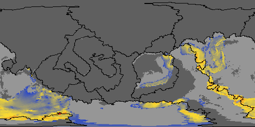
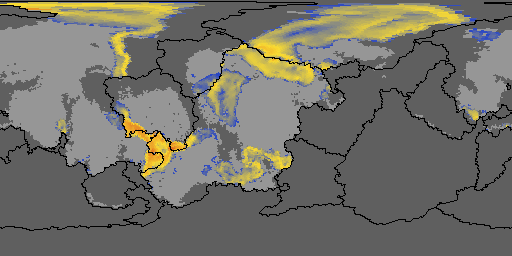
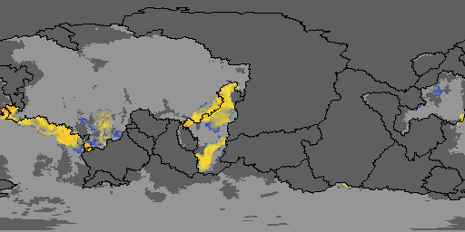

_Strain rate (blue 10⁻¹⁷ → yellow 10⁻¹⁶·⁵ → red 10⁻¹⁴ s⁻¹; grey: rigid, lighter grey
continental; black: plate boundaries)._

## Comparison with `main`

| metric | `main` | branch | t |
|---|---|---|---|
| plates | 28.3 (21.7–31.5) | 22.9 (16.2–31.6) | −2.6 |
| plates > 1% | 17.7 | 15.7 | −1.1 |
| plates born per 100 Myr | 10.5 | 7.8 | −2.7 |
| subduction initiations per 100 Myr | 6.4 | 4.8 | −2.4 |
| sutures per 100 Myr | 0.53 | 0.72 | +0.7 |
| mean plate speed (cm/yr) | 3.94 | 4.09 | +1.4 |
| boundary length (10³ km) | 305 | 273 | −1.7 |
| trenches / ridges (10³ km) | 124 / 114 | 109 / 100 | −2.5 |
| continental collision contacts (10³ km) | 26.7 | 34.1 | +1.0 |
| boundary slower than 2 cm/yr (%) | 13.8 | 15.4 | +0.7 |
| continental boundaries (rift, transform, convergent) (%) | 15.0 | 16.8 | +0.8 |
| transform (%) | 11.7 | 12.9 | +1.5 |
| sea-floor production (km²/yr) | 7.1 | 6.5 | −2.4 |
| mean sea-floor age (Myr) | 50.3 | 51.2 | +0.4 |
| sea floor ≥ 200 Myr (%) | 2.7 | 2.5 | −0.5 |
| continental crust (% of the surface) | 32.9 | 35.2 | +2.4 |
| land (% of the surface) | 27.9 | 30.1 | +4.4 |
| mean land elevation (m) | 671 | 759 | +0.7 |
| highest cell (m) | 4786 | 4019 | −3.2 |
| flooded continental crust (%) | 27.8 | 23.2 | −1.6 |
| crust > 50 km (% of continental crust) | 3.2 | 2.5 | −0.7 |
| shelves, 0 to −200 m (% of the surface) | 6.4 | 5.0 | −2.8 |
| collision stacking (Gt/yr) | 21.9 | 30.5 | +1.1 |
| trench sediment (Gt/yr) | 7.7 | 5.3 | −2.2 |
| sediment part of the sea level (m) | 226 | 191 | −3.6 |
| sediment to the ocean (km³/yr) | 5.2 | 4.4 | −1.2 |
| endorheic land (%) | 19.8 | 19.1 | −0.4 |
| … into single-cell pits (% of land) | 9.1 | 7.4 | −2.4 |
| lakes (% of land) / depressions | 3.4 / 296 | 3.9 / 307 | +1.4 / +0.6 |
| land precipitation (m/yr) | 1.24 | 1.21 | −0.7 |
| global / polar temperature (°C) | 23.4 / −5.1 | 23.1 / −6.0 | −0.9 / −1.4 |
| permanently frozen (%) | 2.7 | 3.3 | +1.5 |
| plate shape: median share within 2 cells of the edge | 0.29 | 0.27 | |
| thin plates (> 60% within 2 cells of the edge, > 1%) per snapshot | 0.15 | 0.09 | |
| run time, 1000 Myr (s; GitHub runners and tktie mixed) | 626 | 694 | +1.4 |

Elevation and plates at 1000 Myr, seed 0 (`main` left, branch right) and seed 3:

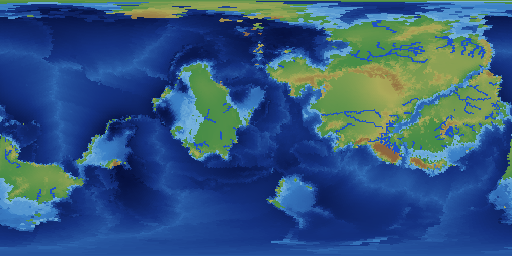 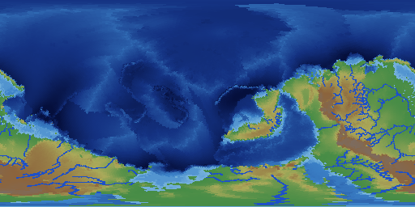
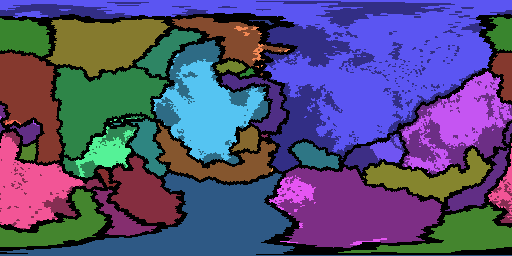 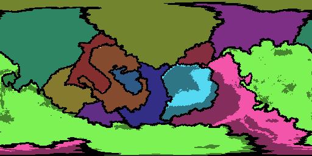
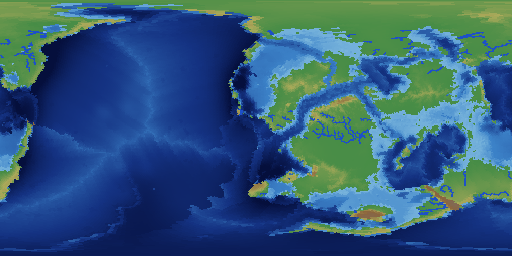 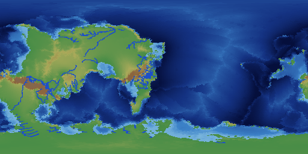
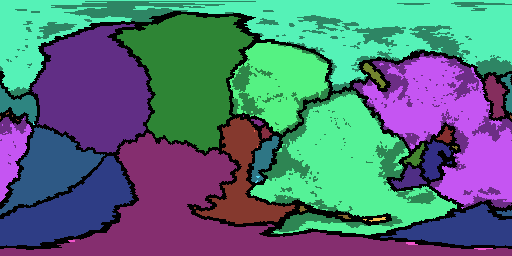 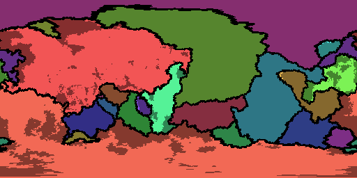

## Key takeaways

1. **Plates now deform where they are weak, and the model stays Earth-like.** About 7% of
   the surface (19% of the continental crust) deforms at plate-boundary-zone rates, almost all
   of it continental: wide orogens and plateaus behind collisions, active margins, the belts of
   old collisions. Rigid plates are the stiff limit (`sheet.enabled=0` = `main`).
2. **Collisions are absorbed by their margins.** Half of the convergence at continental
   collisions goes into shortening and thickening the margins over hundreds of kilometres on
   both sides (the lower plate's pro-wedge too, which the rigid model could not do), the other
   half into the boundary. Collisions last longer (continental contacts +28%, stacking
   +40%), sutures follow the material convergence at the boundary, and convergence continues
   inside the joined plate as deformation (like Asia after India's suture).
3. **Relief is smoother**: thickened crust spreads under its own weight (GPE), so the highest
   cells are ~0.8 km lower (4.0 vs 4.8 km at ~110 km cells) and fewer columns exceed 50 km
   (2.5% vs 3.2%); mean land is ~90 m higher and continental crust covers 2.4 points more of
   the surface (less of it is shortened into the collision stacks of `main`'s narrow belts).
   Flooded continental crust and shelves drop by ~4.5 and ~1.4 points; both stay in their
   plausible ranges (Earth: ~25–30% flooded counting slope and rise).
4. **Fewer, larger plates**: plates −19% (23 vs 28), births −26%, subduction initiations −25%.
   Stresses that a rigid plate transmits to its margins are partly taken up inside it; the
   plates that remain are a little less often thin (#123: thin plates 0.09 vs 0.15 per
   snapshot, few in both).
5. **The boundary mix barely changes** (#43): slow boundaries 15.4% vs 13.8% (Earth 39%),
   continental boundaries 16.8% vs 15.0% (Earth ~30%), within seed scatter. The new slow
   motion is *inside* the plates (diffuse zones), not on discrete boundaries, and splits by
   deformation are rare. Turning diffuse zones into boundaries more readily (lower
   `sheet.split_speed`) would be the lever; not done.
6. **Runtime**: no cost (see [`performance.md`](performance.md)); the deformation costs ~5%
   of a step and a bit-identical fix of the temperature model saves ~8%. 6 subdivisions on the
   desktop are as fast as on `main`.
7. Climate, hydrology and sea floor are essentially unchanged; single-cell pits drain 7.4%
   instead of 9.1% of land (t −2.4), lakes slightly larger.

## Calibration

Done as far as needed (CLAUDE.md: prefer physics over tuning). Steps that were physics fixes,
not tuning, are in the plan's revisions (couplings across boundaries in the solve, GPE across
boundaries, sutures on the material convergence, no thinning weakness, review fixes). Tuned:

| 4 seeds | flooded continental (%) | crust > 50 km (%) | shelves (%) | mean land (m) | collision stacking (Gt/yr) |
|---|---|---|---|---|---|
| `main`, 300–500 Myr | 25.1 | 4.7 | 5.5 | 767 | 24 |
| GPE factor 1 (pre-review code), 300–500 | 18.1 | 8.1 | 4.0 | 1105 | 48 |
| GPE factor 2 (pre-review code), 300–500 | 25.4 | 3.1 | 5.6 | 810 | 40 |
| GPE factor 2 (final), 500–1000, seeds 0–3 | 24.8 | 1.7 | 5.4 | 627 | 22 |
| GPE factor 3 (final), 500–1000 | 21.5 | 1.8 | 4.2 | 838 | 51 |
| GPE 2, continental strength 0.6 (final), 500–1000 | 27.4 | 2.2 | 5.8 | 734 | 32 |

GPE factor 2 is kept; continental strength 0.6 is within seed scatter of 0.5 (it deforms 6% of
the surface instead of 7%) and 0.5 is kept. Other parameters of the model were not changed.

## Caveats

* **Grid**: deforming zones of a few hundred km and more are resolved; faults and narrow shear
  zones are smeared over 1–2 cells, and the upwind transport smears gradients inside deforming
  zones. Plate edges move in steps of a cell (front positions); front cells can be up to ~half
  thinner while they drain.
* **Continental lithosphere ages are thermal ages**: mixing by heat and the McKenzie reset make
  small deformations show as much younger lithosphere (in a 4-seed check the median age of 30–40 km crust was
  ~90–600 Myr instead of the initial 1400+; elevation effect ≲ 100 m, strength effect nil).
* Oceanic lithosphere does not deform (strength floor); oceanic diffuse zones are #42's.
* The GPE factor 2 is a calibration (crust-only Airy energy, the sheet's bulk stiffness);
  ridge push in the sheet is distributed while the torque balance keeps it at the ridge cells.
* The viewer's plate-motion mode shows the deformation live; frames of the history keep only
  the plates' rotations (no frame-format change).

## Queued issues against the new model

| issue | still applies? |
|---|---|
| #161 time text overlaps Live (UI) | unchanged (UI only) |
| #129 deep single-cell pits | applies; slightly fewer (pits drain 7.4% vs 9.1% of land) |
| #112 same-sample twins, option (a) one-to-one resampling | applies: resampling between the plate frames and the cells is unchanged; moving fronts add and remove samples at edges, so (a) must keep them in sync (do it on top of this branch if merged) |
| #160 lakes flicker | applies unchanged (lakes 3.9% vs 3.4% of land, ~same number of depressions) |
| #127 dry depressions water load | applies unchanged |
| #126 lakes as moisture source | applies unchanged |
| #128 render depressions as lake/land | applies unchanged |
| #92 stage 3 atmosphere | unchanged; detail anchoring to the plate frame still works (the frame follows the plate's largest block; deforming zones' detail does not follow their strain) |
| #123 long/narrow plates | partly: thin plates rarer (0.09 vs 0.15 per snapshot) but they were rare already; a strong (old) strip still cannot break (rigid blocks have no plastic yield) |
| #43 boundary mix | still applies: slow/continental boundary shares within scatter of `main`; the slow motion is inside plates now |
| #69 deformable margins | superseded in its aim (the sheet deforms both plates' margins); its collision band is kept for the consumed crust |
| #144 strength proxy weaknesses | point 1 handled in the sheet (oceanic floor, continental factor); the proxy itself (used for splits) unchanged; point 2 (collision fronts unweakened) improved: shortening marks crust orogenic in proportion to the strain |
| #141 crust thickness distribution | applies; continental crust slightly more uniform (fewer > 50 km) |
