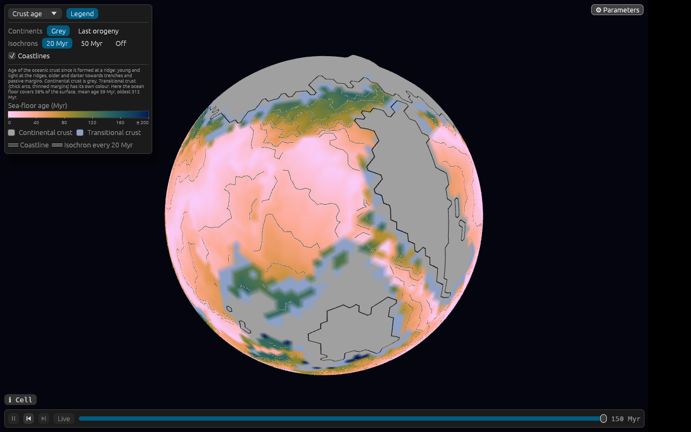

# #98 Crust-age render mode: results

## What was added
- Render mode **Crust age** (`--render-mode crust-age`, `?render-mode=crust-age` on the web):
  `src/viewer/modes/crust_age.rs`. Oceanic crust coloured by sea-floor age on reversed
  *batlow* (0–200 Myr, clamped above; young = light pink/orange, old = dark blue), isochrons
  every 20 Myr (option: 50 Myr, off), coastlines (switch), continental crust grey or graded by
  the time since the last orogeny, transitional crust (thick arcs, thinned margins) greyish blue,
  oceanic crust with a nominal age (≥ 1000 Myr, rare) dark red, legend with the
  sea-floor share, mean and maximum age of the shown frame.
- `CellInfo::OCEANIC` flag (bit 6; the frame history keeps 8 flag bits, so no codec change and
  no frame growth). The cell widget's "Crust" row now distinguishes oceanic / transitional /
  continental; "(ocean floor)" is only added to the age of oceanic crust.
- Works on past frames (all data in the frame since #115).
- No simulation change (state hashes unaffected; the flag is viewer-only).

Checked in the desktop viewer on a virtual screen (5 subdivisions, 150 Myr): options, legend,
isochrons, the orogeny sub-mode and past frames (stepping back) all work. The web version uses
the same switcher code (touch-sized option buttons, collapsible panel); checked by the wasm32
clippy build, not opened in a browser. At the young end batlow is light and changes slowly
(0–40 Myr pink to salmon); the isochrons carry the detail there.

### Why batlow, not a rainbow
Sea-floor age maps (Müller et al. 2008, Seton et al. 2020) traditionally use a rainbow,
red = young to blue = old. Rainbows are not perceptually uniform (false bands at yellow and
cyan) and fail for red–green colour blindness. Crameri's batlow is perceptually uniform with
monotonic lightness and CVD-safe, and keeps the warm-young / blue-old look; Crameri, Shephard &
Heron (2020, Nat. Commun. 11:5444) use the sea-floor age map as their own example. The 11 stops
(every 20 Myr) are sampled from the 256-entry batlow table, linear in between.

### Isochrons
`overlay::isolines` over faces whose three cells are oceanic, on one plate, with an age span
≤ 50 Myr, so that age jumps at trenches, transforms and old sutures do not draw bundles of
parallel lines. Grid caveat (accepted, ~110 km cells): at slow spreading (≲ 1 cm/yr half rate)
the 20 Myr isochrons are only 1–2 cells apart and look jagged; transform offsets shorter than a
cell do not show.

### Not done
The issue mentions continental "formation age" as a sub-mode. The simulation keeps no formation
age of continental crust: its `birth` is a thermal age (nominal 1000 Myr before the start, reset
where a rift thins it), so such a map would be one grey with rift patches. The sub-mode shows the
time since the last orogeny instead. A real formation age would need a new crust tracer
(simulation change), not in scope.

## Plausibility: sea-floor age distribution
Default settings (6 subdivisions, 500 Myr), seeds 0–3, main @ 72d612b (statistics from the
simulation's own log, oceanic crust by `Crust::is_oceanic`; this PR changes no results).

| seed, t | mean | median | 90% | max | share of ocean 0–20 / 20–40 / 40–60 Myr | ≥ 200 Myr |
| --- | --- | --- | --- | --- | --- | --- |
| 0, 500 Myr | 48 | 30 | 107 | 637 | 37 / 21 / 14 % | 2.3% |
| 1, 500 Myr | 58 | 32 | 135 | 646 | 34 / 24 / 13 % | 4.5% |
| 2, 500 Myr | 50 | 33 | 107 | 621 | 33 / 24 / 16 % | 2.1% |
| 3, 500 Myr | 59 | 45 | 115 | 607 | 26 / 20 / 16 % | 2.6% |
| Earth (triangular, max 180) | ~60–65 | ~53 | ~124 | ~180–200 | ~21 / 19 / 16 % | ~0 |

Area per 20 Myr bin, full (seed 0 at 500 Myr): 37 21 14 9 6 4 3 2 1 0 | 2 (≥ 200).

- **Mean** 48–59 Myr looks close to Earth's ~60–65, but only because of the anomalous old tail:
  without the ≥ 200 Myr ocean (seed 0) the mean is about 42 Myr. The sea floor is clearly
  too young overall, consistent with the 0–20 Myr share and the median.
- **Shape**: the area declines roughly exponentially rather than linearly: a third of the sea
  floor is younger than 20 Myr (Earth ~21%), median 30–45 Myr (Earth ~53). This matches
  #32 (sea-floor production ~1.8× Earth's): fast production with consumption that does not
  prefer old crust strongly enough. Comment posted on #32.
- **Tail**: 2–4.5% of the ocean is ≥ 200 Myr, up to ~640 Myr — relict ocean next to continents
  (37–57% of it at continents), the known #14. Earth has essentially none older than ~200 Myr.
- At 100 Myr the distribution is still dominated by the initial triangular ages (mean 63–91).

## Independent results review
No blocking bugs (flag bit 6 survives the history's 8 flag bits, NaN handling and the isochron
filter are sound). Applied: the mean-age conclusion above (the tail inflates it); the
nominal-age swatch relabelled (initial ocean floor older than the start has real ages and is on
the scale); stale `CONTINENTAL` doc; more contrast for the nominal-age colour (now dark red) and
transitional crust (now greyish blue, was lilac, close to the 0 Myr pink); the codec round-trip
test now sets flag bits 5 and 6.
