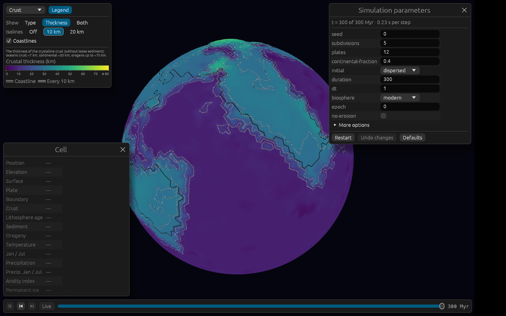

# #99 Crust type and thickness render mode — results

## What was built

Render mode **Crust** (`--render-mode crust`, `?render-mode=crust`), `src/viewer/modes/crust.rs`:

- **Show: Type** — six types (`cell_info::CrustType`), a refinement of the simulation's
  oceanic / transitional / continental classes (same classes as the crust-age mode of PR #140):
  oceanic; arc or plateau (transitional, mafic basement); thinned continental (transitional,
  felsic basement: rifts, passive margins); oceanic arc (continental, mafic basement);
  continental; thick continental (> 50 km: orogens, plateaus). Okabe–Ito colours; the felsic
  family goes yellow → orange → vermillion with thickness, which highlights thinned margins and
  thick orogens as the issue asks. The legend lists the types present in the shown frame.
- **Show: Thickness** — *viridis* 0–80 km (perceptually uniform, monotone lightness,
  colour-blind safe). 
- **Show: Both** — the type colour, lighter for thinner and darker for thicker crust
  (logarithmic 5–80 km; up to 60 % white, 35 % black so that orange and vermillion stay
  apart). The legend shows every type at 7, 15, 35 and 70 km.
- **Isolines** of the thickness (Off / 10 km / 20 km), **coastlines** (on by default).
- Cell widget: the "Crust" row names the type ("thinned continental, 15.2 km").
- Legend (all modes): a colour square now wraps together with its label (before, a long label
  could leave its square at the end of the previous row).

Data: one flag bit, no frame growth. `CellInfo::OCEANIC` (bit 6) is copied verbatim from PR
#140; `CellInfo::FELSIC` (bit 7, basement felsic share > 0.5) is new. All 8 flag bits the frame
history keeps are now used. Simulation results are unchanged.

**Not shown: metamorphosed sediment** (named in the issue). The simulation tracks it as a mass
share, but at 500 Myr only 1.3–2.2 % of the cells have more than 5 % of it and 0.2–0.6 % more
than half (accretionary wedges, about one cell wide). Showing it needs a ninth flag bit or a
share channel (the flags channel widened to 2 bytes, +1 B/cell raw, little after delta + lz4;
past frames are per run, so no compatibility issue). Left for a decision.

Screenshots: desktop [type](crust-type.png), [thickness + 10 km isolines](crust-thickness.png),
[both](crust-both.png); web at phone width (390 px) [type](web-phone-type.png),
[both](web-phone-both.png). The legend and the cell widget fit at 390 px. The screenshots are
short runs (subdivisions 5 or 4, 150–300 Myr), so thick orogens and oceanic arcs barely
appear; `crust-type.png` was taken before the description's "mafic arcs" became "oceanic
arcs". The browser was not emulating a touch screen, so the option buttons have their
mouse size there (touch sizing is the switcher's, unchanged here).

## Plausibility (Earth-like planet), 4 seeds, default settings, 500 Myr

From `--cell-dump` (commit 72d612b, the classification approximated on the whole column).
Shares are of the planet's surface; thickness percentiles p5 / p50 / p95 in km.

| type | seed 0 | seed 1 | seed 2 | seed 3 | thickness (all seeds) |
|---|---|---|---|---|---|
| oceanic | 58.4 % | 60.7 % | 58.8 % | 59.7 % | 7.0 / 7.0 / 7.6–8.3 |
| arc or plateau | 2.0 % | 1.8 % | 1.3 % | 1.4 % | 7–8 / 13 / 18 |
| thinned continental | 5.9 % | 3.3 % | 3.8 % | 4.7 % | 7–9 / 16 / 19 |
| oceanic arc (continental) | 0.1 % | 0.1 % | 0.0 % | 0.0 % | 21 / 23–25 / 26–42 |
| continental ≤ 50 km | 32.3 % | 31.8 % | 35.6 % | 33.8 % | 22–23 / 30 / 45 |
| thick continental > 50 km | 1.3 % | 2.3 % | 0.5 % | 0.4 % | 50 / 52–57 / 55–70 |

- **Oceanic crust ~7 km** as on Earth, but almost uniform (p95 ≤ 8.3 km): the model gives new
  crust a fixed 7 km, with no thinner crust at slow ridges and few oceanic plateaus. Fine for
  an Earth-like planet, but less varied than Earth.
- **Continental crust**: median ~30 km, p95 ~45 km; Earth's continents average ~35–40 km.
  The median is ~30 km already in the initial planet (t = 0: 25 / 31 / 35 km) and stays
  there, so it is a property of the initial conditions plus the thinned margins, not a drift.
  On the thin side, still plausible for an Earth-like planet.
- **Orogens > 50 km**: 0.4–2.3 % of the surface (1–7 % of the continental crust), maximum
  ~70 km, like Tibet and the Andes; plausible.
- **Continental share**: continental 34–36 % plus thinned continental 3–6 % → felsic crust on
  37–40 % of the surface (Earth ~40 % including shelves).
- Coarse grid: margins are one or two cells (110–220 km) wide, so the thinned-continental belt
  and the ocean–continent step are blocky; thickness isolines bunch up at the margins, where the
  thickness changes by ~25 km between neighbouring cells. Accepted grid artefacts.

Follow-up for the weaknesses: #141 (geology, low priority).

## Review

Results evaluation (subagent): the table reproduces from the cell dumps; corrected the
continental share (34–36 %, felsic 37–40 %) and noted the screenshot caveats above.

Plan review: an independent review of plan and draft (subagent) found that the first "Both" shading made the
thick felsic types indistinguishable dark browns (fixed: darkening limited to 35 %), legend
swatches in "Both" showed base colours only (fixed: per-type ramps), the codec test claimed to
cover all flag bits but did not (fixed: bits 0–7), and "mafic arc" was misleading for 40 %
felsic arc crust (renamed "oceanic arc"); confirmed the classification is consistent with the
simulation (all judged on the basement) and that the frame history is per run, so the new flag
needs no codec version bump.
